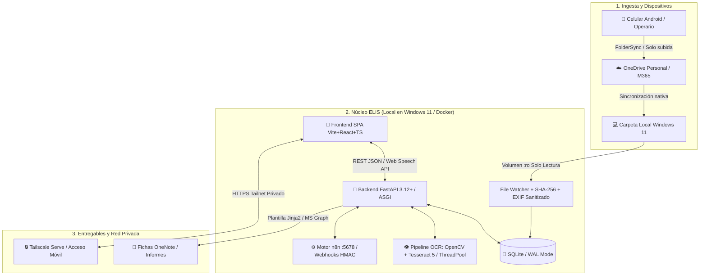
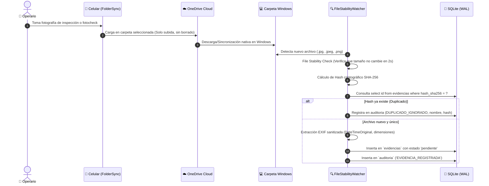
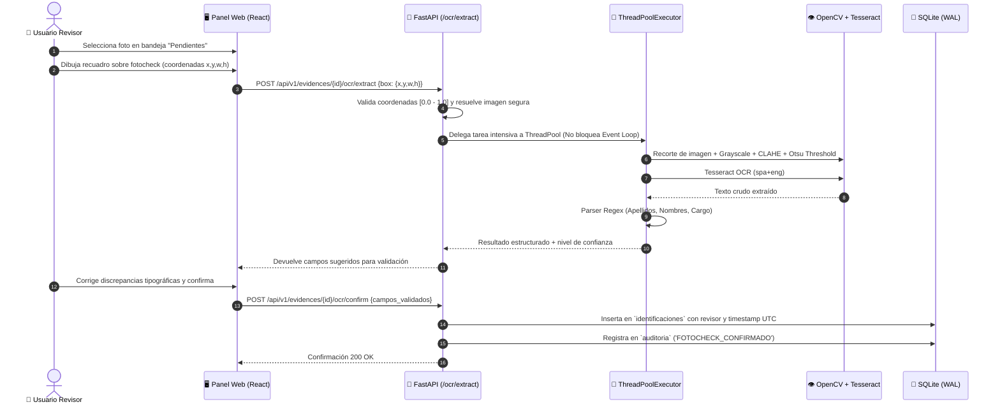
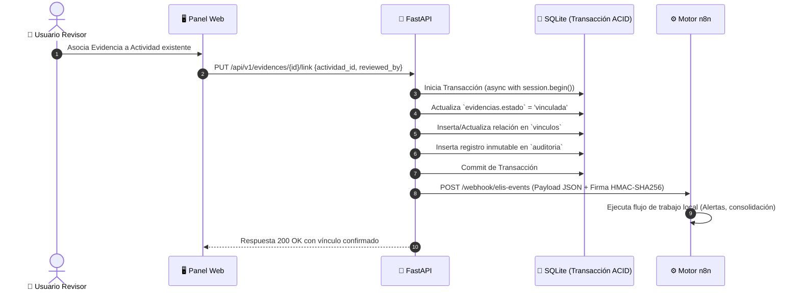
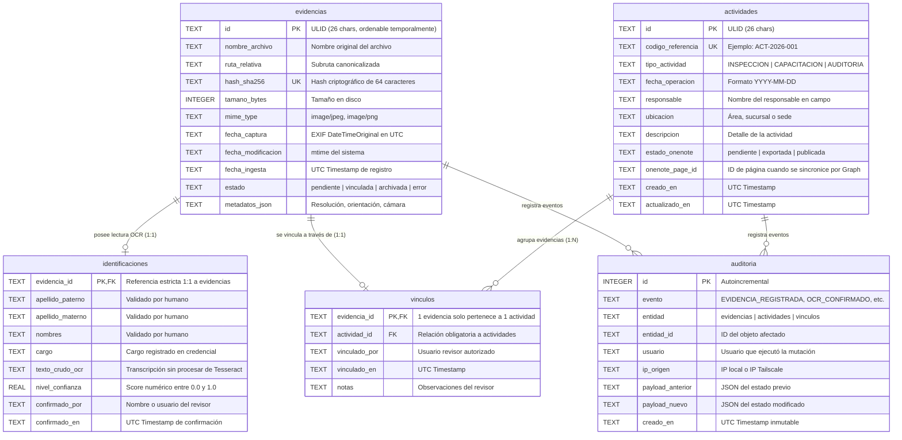

# ELIS 5.0 — Especificación Técnica, Arquitectura y Guía de Desarrollo Unificada

> **Documento Maestro de Arquitectura y Requerimientos de Software (SRS/SAD) — Versión Auditada**  
> **Consolidación de:** `README.md`, `OBJETIVO_Y_ALCANCE.md`, `ARQUITECTURA.md`, `API_LOCAL.md` y `MEMORIA_Y_MODELO_DE_DATOS.md`  
> **Versión:** 5.0.0-PROD (Auditoría Técnica Superada)  
> **Clasificación:** Confidencial / Repositorio Privado  
> **Estado:** Documento de Especificación de Producción  

---

## 1. Visión, Objetivos y Principios Rectores

### 1.1 Propósito y Problema de Negocio
En operaciones de campo, supervisión técnica, evaluaciones e inspecciones de Seguridad, Salud en el Trabajo y Medio Ambiente (HSE/SST), los registros operativos (fotografías de inspecciones, credenciales/fotochecks, fichas de campo y reportes diarios) suelen dispersarse en múltiples canales no controlados (galerías de teléfonos personales, chats de mensajería instantánea, carpetas locales y hojas de cálculo no estandarizadas). 

Esto genera:
* **Pérdida de trazabilidad y cadena de custodia:** No hay certeza del momento de captura ni del autor.
* **Duplicación masiva de archivos:** Archivos idénticos guardados en diferentes carpetas consumen almacenamiento innecesario.
* **Riesgo de asociaciones erróneas:** Asignación de evidencias a inspecciones o trabajadores equivocados.
* **Cargas operativas manuales y lentas:** Compilación manual de minutas, bitácoras para OneNote o informes directivos.

**ELIS (Entorno Local Inteligente y Seguro)** nace como un **asistente personal local modular y automatizado** que centraliza la ingesta documental, ejecuta flujos de automatización, indexa evidencias de manera segura y mantiene una **memoria auditada e inmutable** en el propio equipo del usuario (Windows 11), sin depender de servidores VPS públicos ni almacenamiento de terceros no autorizado.



---

### 1.2 Principios Éticos y Reglas de Negocio Inmutables

Cualquier implementación del código debe apegarse estrictamente a las siguientes 5 reglas inmutables:

1. **Gobernanza "Human-in-the-Loop" Obligatoria:**  
   ELIS **no infiere ni inventa inspecciones**. Jamás asocia automáticamente una foto a un operario o a una infracción basándose únicamente en similitud visual o cercanía temporal. Toda vinculación requiere confirmación explícita de un revisor humano registrado.
2. **Prohibición Total de Reconocimiento Facial / Biometría:**  
   ELIS **no realiza detección ni reconocimiento facial**. El módulo de fotochecks extrae exclusivamente texto impreso en credenciales mediante OCR guiado por un recorte manual del usuario.
3. **Integridad Absoluta de Archivos Originales (`:ro`):**  
   Los directorios que contienen fotografías originales se montan como volúmenes de **solo lectura**. ELIS no renombra, no mueve y no borra archivos fuente.
4. **Local-First y Privacidad por Diseño (Privacy-Preserving EXIF):**  
   El procesamiento de datos, base SQLite, motor OCR y servidor de automatización corren en la máquina local. Se extrae `DateTimeOriginal` y dimensiones técnicas; coordenadas GPS o números de serie de dispositivos se descartan/anonimizan por defecto para proteger la privacidad del trabajador.
5. **Diferenciación entre "Guardado Local" y "Publicado":**  
   Una ficha exportada en HTML se marca como `exportada` (local); únicamente se marcará como `publicada` cuando una integración real de API (ej. Microsoft Graph) confirme la transacción con código HTTP 201/200.

---

## 2. Pila Tecnológica Auditada (Target Stack)

| Capa | Componente | Versión / Librería | Decisión de Auditoría y Justificación Técnica |
|---|---|---|---|
| **Runtime Backend** | Python | **3.12+ (64-bit)** | Tipado estático nativo avanzado, mejoras de velocidad de hasta 25% y soporte para ASGI asíncrono. |
| **Framework Web** | FastAPI | **0.115+** | Totalmente asíncrono (`async/await`), validación estricta en runtime con Pydantic v2, generación automática de OpenAPI (Swagger/ReDoc). |
| **Servidor ASGI** | Uvicorn | **0.30+ (con uvloop)** | Servidor ASGI ultrarrápido para manejar alta concurrencia local. |
| **ORM / Acceso a Datos** | SQLModel / SQLAlchemy 2.0 Async | **SQLAlchemy Async con `aiosqlite`** | Manejo de sesiones async, tipado completo y prevención nativa de inyecciones SQL. |
| **Base de Datos** | SQLite | **Modo WAL (`journal_mode=WAL`)** | `PRAGMA busy_timeout = 30000`, `PRAGMA foreign_keys = ON`, `PRAGMA synchronous = NORMAL`. Evita bloqueos en lecturas y escrituras simultáneas. |
| **Migraciones** | Alembic | **1.13+** | Control de versiones y evolución del esquema de la base de datos sin pérdida de datos. |
| **Preprocesamiento OCR** | OpenCV (headless) | **opencv-python-headless 4.10+** | Conversión a escala de grises, corrección de inclinación (*deskew*), aumento de contraste CLAHE y binarización adaptativa Otsu. |
| **Motor OCR** | Tesseract OCR | **Tesseract 5.x (`tesseract-ocr`, `tesseract-ocr-spa`)** | Ejecución desacoplada del Event Loop mediante `asyncio.to_thread` / `ThreadPoolExecutor` para no bloquear el servidor web. |
| **Metadatos de Imagen** | Pillow + Piexif | **Pillow 10.4+** | Extracción segura de EXIF y generación de miniaturas WebP de 300px en memoria/caché. |
| **Frontend** | React + TypeScript | **React 18+, Vite, TailwindCSS, Lucide React** | SPA moderna, modular, tipado estricto, canvas interactivo para recorte de fotochecks y visualizador de voz Web Audio API. |
| **Voz / Audio** | Web Speech API | **`SpeechRecognition` + `SpeechSynthesis`** | Reconocimiento y síntesis nativa del navegador en `es-PE`. Cero costos, cero dependencias en la nube. |
| **Automatización** | n8n | **docker.n8n.io/n8nio/n8n:2.42.3+** | Motor de flujos con autenticación interna y webhooks firmados criptográficamente (HMAC-SHA256). |
| **Aislamiento** | Docker Compose | **Compose v2 (Hardened Profile)** | Contenedores con `read_only: true`, `cap_drop: ALL`, usuarios no-root y healthchecks integrados. |
| **Acceso Móvil** | Tailscale | **Tailscale Serve (TLS Interno)** | VPN privada Mesh. No abre puertos en el router, no expone servicios a la WAN y cifra el tráfico de extremo a extremo. |

---

## 3. Arquitectura del Sistema y Flujos de Datos

### 3.1 Arquitectura por Capas Limpias (Clean Architecture)

```text
┌────────────────────────────────────────────────────────────────────────┐
│                   CAPA DE PRESENTACIÓN (CLIENTE)                      │
│   - Panel Web SPA (React / Vite / TypeScript / TailwindCSS)            │
│   - Módulo de Voz: Web Speech API (es-PE) + Web Audio Waveform         │
│   - Canvas de Recorte Interactivo: Zoom, Rotación y Bounding Box       │
└───────────────────────────────────┬────────────────────────────────────┘
                                    │ HTTPS (Tailscale) / REST JSON
┌───────────────────────────────────▼────────────────────────────────────┐
│                  CAPA DE APLICACIÓN Y API (FASTAPI)                    │
│   - Routers v1: /auth, /evidences, /activities, /ocr, /n8n, /audit     │
│   - Middlewares: SecurityHeaders, RateLimiter (TokenBucket), RequestId │
│   - Manejador Global de Excepciones: Respuestas Estándar RFC 7807      │
└───────────────────┬───────────────────────────────┬────────────────────┘
                    │                               │
┌───────────────────▼─────────────┐   ┌─────────────▼────────────────────┐
│   CAPA DE DOMINIO Y SERVICIOS   │   │     SERVICIOS DE INTEGRACIÓN     │
│  - EvidenceService              │   │  - N8nWebhookClient (HMAC-SHA256)│
│  - OcrProcessingEngine (OpenCV) │   │  - FileStabilityWatcherService   │
│  - ActivityService              │   │  - OneNoteDocumentBuilder (Jinja)│
│  - AuditLoggerService           │   │  - ExifSanitizerService          │
└───────────────────┬─────────────┘   └─────────────┬────────────────────┘
                    │                               │
┌───────────────────▼───────────────────────────────▼────────────────────┐
│               CAPA DE INFRAESTRUCTURA Y PERSISTENCIA                  │
│  - Repositorios Async SQLAlchemy (SQLite WAL Mode + busy_timeout)      │
│  - File System Adapter: Validación contra Path Traversal (:ro volume)  │
│  - Red Interna Docker: elis-internal-net (Aislada de la WAN)           │
└────────────────────────────────────────────────────────────────────────┘
```

---

### 3.2 Flujos Operativos y Diagramas de Secuencia

#### Flujo 1: Ingesta Resiliente y Deduplicación Criptográfica


#### Flujo 2: OCR Interactivo de Fotochecks Desacoplado


#### Flujo 3: Vinculación Atómica a Actividades y Disparo de n8n


---

## 4. Especificación Rigurosa de la API REST v1

### 4.1 Autenticación y Autorización
Todos los endpoints protegidos requieren el encabezado:
```http
X-ELIS-Key: <TOKEN_CRIPTO_DE_32_BYTES>
```
* **Mecanismo de validación:** Comparación en tiempo constante usando `secrets.compare_digest()` para prevenir ataques de temporización (*Timing Attacks*).
* **Protección contra fuerza bruta:** Middleware de Rate Limiting con algoritmo Token Bucket por IP (`10 intentos fallidos por ventana de 15 minutos = Bloqueo temporal`).

### 4.2 Formato Unificado de Respuestas y Manejo de Errores (RFC 7807)

#### Respuesta Exitosa:
```json
{
  "ok": true,
  "data": { ... },
  "meta": {
    "timestamp": "2026-10-13T17:55:00Z",
    "request_id": "req_01J8F9X7M2"
  }
}
```

#### Respuesta de Error (RFC 7807 Problem Details):
```json
{
  "ok": false,
  "error": {
    "type": "https://elis.local/errors/not-found",
    "title": "Evidencia no encontrada",
    "status": 404,
    "code": "ERR_EVIDENCE_NOT_FOUND",
    "detail": "No se encontró ningún registro para el identificador proporcionado.",
    "instance": "/api/v1/evidences/01J8F9X7M2",
    "request_id": "req_01J8F9X7M2",
    "timestamp": "2026-10-13T17:55:00Z"
  }
}
```

---

### 4.3 Catálogo Detallado de Endpoints

| Método | Ruta | Parámetros / Body | Códigos HTTP | Propósito |
|---|---|---|---|---|
| `GET` | `/api/v1/health` | Ninguno | `200` | Healthcheck para Docker y balanceadores. |
| `GET` | `/api/v1/system/status` | Ninguno | `200`, `401` | Estado de SQLite, n8n, volumen montado y memoria. |
| `GET` | `/api/v1/evidences` | Query: `status`, `query`, `page`, `page_size` | `200`, `401`, `422` | Listado paginado de evidencias fotográficas. |
| `POST` | `/api/v1/evidences/scan` | Ninguno | `202`, `401` | Dispara escaneo asíncrono manual de la carpeta. |
| `GET` | `/api/v1/evidences/{id}/image` | Query: `thumb=true/false` | `200`, `401`, `404`, `503` | Entrega segura de imagen (con control de Path Traversal). |
| `PATCH` | `/api/v1/evidences/{id}/status` | Body: `{"status": "archivada", "reason": "..."}` | `200`, `401`, `404`, `422` | Cambia estado a `archivada` o `pendiente`. |
| `POST` | `/api/v1/evidences/{id}/ocr/extract` | Body: `{"box": {"x": 0.1, "y": 0.2, "w": 0.4, "h": 0.5}}` | `200`, `401`, `404`, `422` | Extrae texto preliminar mediante recorte OpenCV+Tesseract. |
| `POST` | `/api/v1/evidences/{id}/ocr/confirm` | Body: `{"apellido_paterno": "...", "nombres": "...", ...}` | `200`, `401`, `404`, `422` | Guarda campos validados manualmente por el revisor. |
| `GET` | `/api/v1/activities` | Query: `query`, `page`, `page_size` | `200`, `401` | Lista actividades de campo registradas. |
| `POST` | `/api/v1/activities` | Body: `{"tipo": "...", "fecha": "...", "descripcion": "..."}` | `201`, `401`, `422` | Registra una nueva actividad real. |
| `PUT` | `/api/v1/evidences/{id}/link` | Body: `{"actividad_id": "...", "reviewed_by": "..."}` | `200`, `401`, `404`, `409` | Vincula evidencia a actividad (operación atómica e idempotente). |
| `GET` | `/api/v1/activities/{id}/export/onenote` | Ninguno | `200`, `401`, `404` | Descarga ficha HTML autocontenida para OneNote. |
| `POST` | `/api/v1/commands/process` | Body: `{"phrase": "¿cuántas fotos pendientes hay?"}` | `200`, `401`, `422` | Intérprete semántico de comandos de voz y texto. |
| `GET` | `/api/v1/audit/logs` | Query: `limit`, `event_type`, `since` | `200`, `401` | Historial cronológico inmutable de acciones. |

---

## 5. Modelo de Datos Relacional y Esquema SQLite (WAL)



### 5.1 Índices de Alta Velocidad Requeridos
```sql
CREATE UNIQUE INDEX IF NOT EXISTS idx_evidencias_hash ON evidencias(hash_sha256);
CREATE INDEX IF NOT EXISTS idx_evidencias_estado ON evidencias(estado);
CREATE INDEX IF NOT EXISTS idx_evidencias_fecha ON evidencias(fecha_ingesta DESC);
CREATE INDEX IF NOT EXISTS idx_vinculos_actividad ON vinculos(actividad_id);
CREATE INDEX IF NOT EXISTS idx_auditoria_entidad ON auditoria(entidad, entidad_id);
```

---

## 6. Seguridad Integral y Blindaje de Infraestructura

### 6.1 Prevención de Vulnerabilidades Críticas

#### A. Mitigación Rigurosa de Path Traversal
El servicio de entrega de imágenes nunca recibe nombres de archivo directos del cliente:
1. El cliente solicita `/api/v1/evidences/{id}/image`.
2. El backend consulta el registro en SQLite por su `id` (ULID) seguro.
3. Se obtiene `ruta_relativa` y se compone con el directorio base de fotos montado:
   ```python
   base_dir = Path("/evidencias_entrada").resolve()
   target_path = (base_dir / record.ruta_relativa).resolve()
   
   if not target_path.is_relative_to(base_dir) or not target_path.is_file() or target_path.is_symlink():
       raise PermissionError("Acceso a ruta de sistema denegado.")
   ```

#### B. Prevención de SSRF (Server-Side Request Forgery)
Las peticiones salientes hacia n8n están fijadas a la dirección interna de la red de Docker (`http://automatizaciones:5678`). Ningún parámetro de usuario puede alterar el protocolo, host o puerto de destino. Cada solicitud saliente lleva una firma criptográfica en el encabezado `X-ELIS-Signature: sha256=<HMAC>` generada con una clave simétrica compartida.

#### C. Cabeceras HTTP de Seguridad
El middleware inyecta en cada respuesta:
```http
Content-Security-Policy: default-src 'self'; img-src 'self' data:; style-src 'self' 'unsafe-inline'; script-src 'self'; connect-src 'self'; frame-ancestors 'none'; base-uri 'none';
X-Content-Type-Options: nosniff
X-Frame-Options: DENY
Referrer-Policy: no-referrer
Permissions-Policy: microphone=(self)
```

---

## 7. Estructura de Directorios para Desarrollo (Clean Code)

```text
ELIS/
├── .env.example                     # Variables de entorno documentadas
├── compose.yaml                     # Orquestación Docker Compose v2 (Hardened)
├── README.md                        # Documentación general de alto nivel
├── docs/                            # Documentación técnica
│   ├── ARQUITECTURA_Y_ESPECIFICACION_MODERNA.md
│   └── ...
├── backend/                         # Módulo FastAPI (Python 3.12+)
│   ├── Dockerfile
│   ├── pyproject.toml
│   ├── app/
│   │   ├── main.py                  # Punto de entrada ASGI (FastAPI + Uvicorn)
│   │   ├── core/
│   │   │   ├── config.py            # Pydantic Settings
│   │   │   ├── security.py          # Comparación de secretos y hashing
│   │   │   ├── exceptions.py        # Jerarquía de excepciones RFC 7807
│   │   │   └── middlewares.py       # RateLimiter, RequestId, SecurityHeaders
│   │   ├── db/
│   │   │   ├── session.py           # Conexión async a SQLite WAL con timeouts
│   │   │   ├── models.py            # Modelos SQLModel (Tablas)
│   │   │   └── migrations/          # Versionado con Alembic
│   │   ├── schemas/                 # Esquemas Pydantic v2 (DTOs)
│   │   │   ├── evidence.py
│   │   │   ├── activity.py
│   │   │   └── ocr.py
│   │   ├── services/                # Lógica pura desacoplada
│   │   │   ├── evidence_service.py  # Deduplicación SHA-256 y miniaturas
│   │   │   ├── ocr_engine.py        # OpenCV + Tesseract en ThreadPool
│   │   │   ├── file_watcher.py      # Estabilidad de archivos OneDrive
│   │   │   ├── n8n_client.py        # Webhooks firmados con HMAC
│   │   │   └── onenote_builder.py   # Renderizador Jinja2 para fichas
│   │   └── api/
│   │       └── v1/
│   │           ├── router.py
│   │           ├── evidences.py
│   │           ├── activities.py
│   │           ├── ocr.py
│   │           └── system.py
│   └── tests/
│       ├── test_evidence.py
│       └── test_ocr.py
├── frontend/                        # Frontend Moderno SPA
│   ├── package.json
│   ├── vite.config.ts
│   ├── src/
│   │   ├── components/
│   │   │   ├── Avatar.tsx           # Avatar interactivo con estados de voz
│   │   │   ├── CropCanvas.tsx       # Lienzo de selección para OCR
│   │   │   ├── EvidenceCard.tsx     # Card de evidencia con estado
│   │   │   └── VoiceVisualizer.tsx  # Onda de audio en tiempo real
│   │   ├── hooks/
│   │   │   ├── useSpeech.ts         # Hook para Web Speech API
│   │   │   └── useEvidences.ts      # Hook TanStack Query para caché
│   │   ├── services/api.ts          # Cliente Axios/Fetch tipado
│   │   └── App.tsx
└── scripts/                         # Automatización en Windows
    ├── Iniciar-Elis.ps1
    ├── Respaldar-Elis.ps1
    └── Restaurar-Elis.ps1
```

---

## 8. Guía de Ejecución y Hoja de Ruta de Programación

1. **Sprint 1 — Núcleo Asíncrono y Base de Datos (Días 1-2):**
   * Configurar `backend/` con `pyproject.toml` (FastAPI, uvicorn, sqlmodel, aiosqlite, pydantic-settings).
   * Implementar `session.py` configurando `PRAGMA journal_mode=WAL;` y `PRAGMA busy_timeout=30000;`.
   * Crear tablas en `models.py` e inicializar migraciones con Alembic.
2. **Sprint 2 — Servicio de Evidencias e Ingesta Segura (Días 3-4):**
   * Programar `file_watcher.py` con verificación de estabilidad de archivo (2 segundos sin cambios de tamaño).
   * Crear `evidence_service.py` con cálculo en streaming de SHA-256 y extracción sanitizada de EXIF.
   * Implementar endpoints `/api/v1/evidences` y `/api/v1/evidences/{id}/image` con protección anti-path traversal.
3. **Sprint 3 — Pipeline OCR con OpenCV y ThreadPool (Días 5-6):**
   * Configurar OpenCV y Tesseract 5 en Dockerfile.
   * Implementar `ocr_engine.py` desacoplado del event loop mediante `asyncio.to_thread`.
   * Crear parser semántico de expresiones regulares para credenciales peruanas (Apellidos, Nombres, Cargo).
   * Exponer endpoints `/api/v1/evidences/{id}/ocr/extract` y `/api/v1/evidences/{id}/ocr/confirm`.
4. **Sprint 4 — Automatizaciones n8n y Fichas OneNote (Días 7-8):**
   * Configurar `n8n_client.py` con firmas criptográficas HMAC-SHA256 en webhooks salientes.
   * Implementar generador de plantillas Jinja2 para exportación de fichas HTML autocontenidas.
5. **Sprint 5 — Frontend Moderno y Módulo de Voz (Días 9-11):**
   * Inicializar proyecto Vite + React 18 + TailwindCSS.
   * Crear el componente `CropCanvas.tsx` con soporte para mouse y pantallas táctiles (Android).
   * Integrar `useSpeech.ts` con visualizador de audio en tiempo real y animación del avatar.
6. **Sprint 6 — Docker Hardening, Pruebas y Despliegue (Días 12-13):**
   * Crear Dockerfile multi-stage y `compose.yaml` blindado (`read_only: true`, `cap_drop: ALL`).
   * Ejecutar suite de pruebas unitarias e integrales con `pytest` y `httpx`.
   * Probar flujo de extremo a extremo desde Android vía Tailscale Serve.
