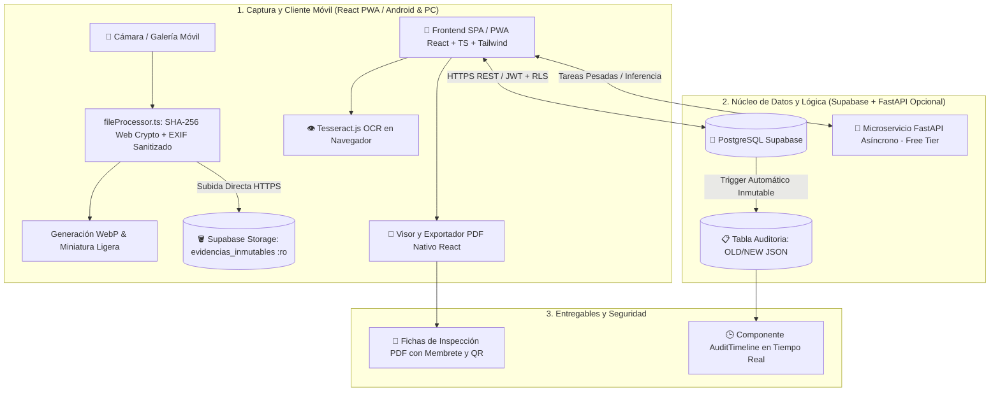
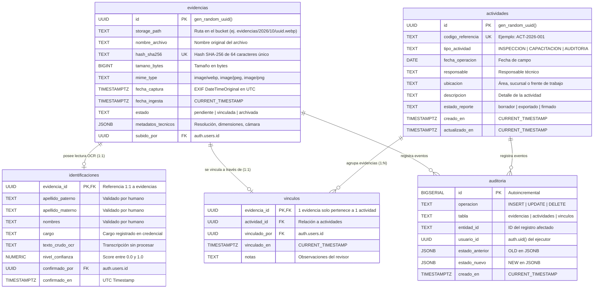
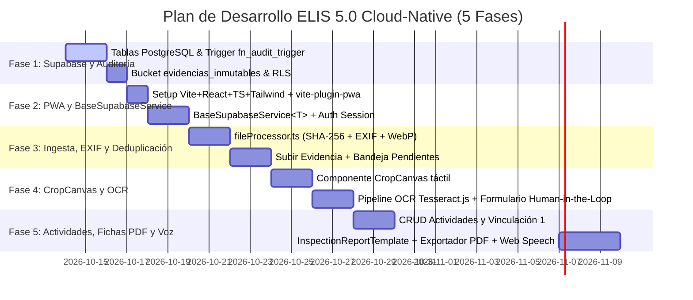

# ELIS 5.0 — Especificación Técnica, Arquitectura y Guía de Desarrollo Unificada

> **Documento Maestro de Arquitectura y Requerimientos de Software (SRS/SAD) — Edición Cloud-Native (Zero-Docker / Free-Tier)**  
> **Versión:** 5.0.0-CLOUD-NATIVE (Auditoría Técnica Superada)  
> **Clasificación:** Confidencial / Repositorio Privado  
> **Estado:** Documento de Especificación Activo para Producción  

---

## 1. Visión, Objetivos y Principios Rectores

### 1.1 Propósito y Problema de Negocio
En operaciones de campo, supervisión técnica, evaluaciones e inspecciones de Seguridad, Salud en el Trabajo y Medio Ambiente (HSE/SST), los registros operativos (fotografías de inspecciones, credenciales/fotochecks, fichas de campo y reportes diarios) suelen dispersarse en múltiples canales no controlados (galerías de teléfonos personales, chats de mensajería instantánea, carpetas locales y hojas de cálculo no estandarizadas).

Esto genera:
* **Pérdida de trazabilidad y cadena de custodia:** No hay certeza del momento de captura ni del autor.
* **Duplicación masiva de archivos:** Archivos idénticos guardados en diferentes carpetas consumen almacenamiento innecesario.
* **Riesgo de asociaciones erróneas:** Asignación de evidencias a inspecciones o trabajadores equivocados.
* **Cargas operativas manuales y lentas:** Compilación manual de minutas, reportes rígidos y dependientes de ecosistemas propietarios (como OneNote/Azure AD) que caducan y no permiten control visual.
* **Sobrecarga de hardware local:** Obligar a una laptop a mantenerse encendida procesando Docker, n8n o esperando que archivos sincronicen por carpetas locales consume RAM y batería de forma ineficiente.

**ELIS (Entorno Local Inteligente y Seguro) 5.0 Cloud-Native** evoluciona hacia una arquitectura **PWA Local-First / Cloud-Native**:
* **Subida directa desde el navegador móvil** hacia Buckets S3-compatibles (Supabase Storage o Cloudflare R2).
* **Cálculo criptográfico en el cliente** (Web Crypto API SHA-256 en milisegundos en el celular).
* **Base de datos Postgres gestionada 24/7 (Supabase)** con políticas RLS inmutables y triggers automáticos de auditoría.
* **Generación nativa de Fichas Técnicas y Reportes PDF** en React con control estético del 100%, eliminando la dependencia rígida de Microsoft OneNote y Graph API.
* **Cero consumo ocioso de RAM en tu equipo ($0 costo en capas gratuitas).**



---

### 1.2 Principios Éticos y Reglas de Negocio Inmutables

Cualquier implementación del código debe apegarse estrictamente a las siguientes 5 reglas inmutables:

1. **Gobernanza "Human-in-the-Loop" Obligatoria:**  
   ELIS **no infiere ni inventa inspecciones**. Jamás asocia automáticamente una foto a un operario o a una infracción basándose únicamente en similitud visual o cercanía temporal. Toda vinculación requiere confirmación explícita de un revisor humano registrado.
2. **Prohibición Total de Reconocimiento Facial / Biometría:**  
   ELIS **no realiza detección ni reconocimiento facial**. El módulo de fotochecks extrae exclusivamente texto impreso en credenciales mediante OCR guiado por un recorte manual del usuario.
3. **Integridad Absoluta de Evidencias Originales (`:ro` vía RLS):**  
   En Supabase Storage / Cloudflare R2 se configuran políticas estrictas donde los clientes solo tienen permisos de `INSERT` y `SELECT`, pero **jamás `UPDATE` ni `DELETE`**. Una vez subida la evidencia original, el archivo es inmutable.
4. **Auditoría Transaccional e Inmutable por Trigger:**  
   En lugar de depender exclusivamente de auditorías manuales en backend, la base de datos PostgreSQL ejecuta **Triggers automáticos a nivel de motor**. Cualquier inserción, actualización o eliminación en tablas sensibles (`evidencias`, `actividades`, `vinculos`) guarda de forma atómica e ineludible el estado previo (`OLD`) y posterior (`NEW`) en formato JSON.
5. **Deduplicación Criptográfica en Cliente y Base de Datos:**  
   Antes de subir cualquier archivo, el cliente calcula el SHA-256 usando la **Web Crypto API**. La columna `hash_sha256` en PostgreSQL tiene restricción `UNIQUE`, rechazando al instante cualquier evidencia repetida sin consumir ancho de banda de subida innecesario.

---

## 2. Pila Tecnológica Cloud-Native ($0 Costo / Control Total)

| Componente | Solución Tradicional (Obsoleta) | Nueva Solución ELIS 5.0 Cloud-Native | Justificación Técnica y Beneficio |
|---|---|---|---|
| **Base de Datos & Auth** | SQLite Local + Auth manual | **Supabase (PostgreSQL 15+ & GoTrue Auth & RLS)** | Accesible 24/7 desde el celular sin depender de que la PC esté prendida. Políticas RLS granulares y Triggers automáticos. |
| **Ingesta de Evidencias** | FolderSync + OneDrive + FileWatcher local | **React PWA + Web Crypto API + Direct Storage Upload** | Captura directa desde la cámara del celular. SHA-256 instantáneo en cliente; verificación de duplicados previa a la subida. |
| **Almacenamiento de Fotos** | Disco local Windows + OneDrive | **Supabase Storage / Cloudflare R2** | 1 GB gratis en Supabase (~3,000 fotos WebP) o 10 GB gratis en R2 sin cobro de ancho de banda. Acceso seguro por URLs firmadas. |
| **Generación de Fichas** | OneNote vía Microsoft Graph API | **Módulo React + Generador PDF (@react-pdf/renderer)** | Elimina tokens caducados de Azure AD y plantillas HTML rígidas. Control estético total en Tailwind con membrete corporativo e historial de auditoría. |
| **Motor OCR** | OpenCV + Tesseract en PC (pesado) | **Tesseract.js (Navegador) o FastAPI Asíncrono** | Tesseract.js ejecuta el OCR usando la CPU del cliente solo durante los 2 segundos de lectura, o delega a un backend ligero. |
| **Automatización y Tareas** | n8n en contenedor Docker local | **Python Async BackgroundTasks / Database Webhooks** | Cero consumo de RAM de fondo. Tareas desacopladas, alertas y llamadas a webhooks administradas por eventos puros. |
| **Frontend Móvil y Web** | SPA tradicional en localhost | **PWA (React 18+, TypeScript, Vite, TailwindCSS)** | Instalable en Android/iOS como aplicación nativa, soporte offline parcial y acceso directo a la cámara. |
| **Gobernanza de Código** | Desarrollo disperso sin verificación | **Antigravity + Graphify + MCP** | Reglas de arquitectura inyectadas, verificación automática de servicios base y navegación viva del AST/código. |

---

## 3. Modelo de Datos Relacional y Auditoría Inmutable (PostgreSQL / Supabase)

### 3.1 Diagrama de Entidad-Relación



### 3.2 Script DDL y Trigger Inmutable de Auditoría en PostgreSQL
```sql
-- Habilitar extensión UUID
CREATE EXTENSION IF NOT EXISTS "pgcrypto";

-- Tabla de Auditoría Inmutable
CREATE TABLE IF NOT EXISTS public.auditoria (
    id BIGSERIAL PRIMARY KEY,
    operacion TEXT NOT NULL,
    tabla TEXT NOT NULL,
    entidad_id TEXT NOT NULL,
    usuario_id UUID,
    estado_anterior JSONB,
    estado_nuevo JSONB,
    creado_en TIMESTAMPTZ DEFAULT CURRENT_TIMESTAMP NOT NULL
);

-- Función del Trigger de Auditoría Universal
CREATE OR REPLACE FUNCTION public.fn_audit_trigger()
RETURNS TRIGGER AS $$
BEGIN
    INSERT INTO public.auditoria (
        operacion,
        tabla,
        entidad_id,
        usuario_id,
        estado_anterior,
        estado_nuevo
    ) VALUES (
        TG_OP,
        TG_TABLE_NAME,
        COALESCE(NEW.id::TEXT, OLD.id::TEXT, NEW.evidencia_id::TEXT, OLD.evidencia_id::TEXT),
        auth.uid(),
        CASE WHEN TG_OP IN ('UPDATE', 'DELETE') THEN to_jsonb(OLD) ELSE NULL END,
        CASE WHEN TG_OP IN ('INSERT', 'UPDATE') THEN to_jsonb(NEW) ELSE NULL END
    );
    RETURN COALESCE(NEW, OLD);
END;
$$ LANGUAGE plpgsql SECURITY DEFINER;

-- Disparadores automáticos en tablas maestras
CREATE TRIGGER tr_audit_evidencias
AFTER INSERT OR UPDATE OR DELETE ON public.evidencias
FOR EACH ROW EXECUTE FUNCTION public.fn_audit_trigger();

CREATE TRIGGER tr_audit_actividades
AFTER INSERT OR UPDATE OR DELETE ON public.actividades
FOR EACH ROW EXECUTE FUNCTION public.fn_audit_trigger();

CREATE TRIGGER tr_audit_vinculos
AFTER INSERT OR UPDATE OR DELETE ON public.vinculos
FOR EACH ROW EXECUTE FUNCTION public.fn_audit_trigger();
```

---

## 4. Arquitectura de Software y Reutilización (Clean PWA & Backend)

### 4.1 Frontend PWA (React + TypeScript)
Estructura modular orientada a reutilización con **Antigravity** y consulta mediante **Graphify**:

```text
frontend/
├── public/
│   ├── manifest.json                  # Configuración PWA (instalable en Android)
│   └── sw.js                          # Service Worker para caché de assets
├── src/
│   ├── components/
│   │   ├── ui/                        # Componentes atómicos con TailwindCSS
│   │   │   ├── StatusBadge.tsx        # Insignias de estado estandarizadas
│   │   │   ├── AuditTimeline.tsx      # Historial dinámico desde public.auditoria
│   │   │   ├── Modal.tsx
│   │   │   └── Button.tsx
│   │   ├── ocr/
│   │   │   ├── CropCanvas.tsx         # Canvas táctil con rotación y zoom para recorte
│   │   │   └── OcrResultEditor.tsx    # Formulario de confirmación humana
│   │   ├── evidence/
│   │   │   ├── EvidenceUploader.tsx   # Subida con drag&drop y acceso directo a cámara
│   │   │   ├── EvidenceGrid.tsx       # Galería virtualizada con miniaturas WebP
│   │   │   └── EvidenceCard.tsx
│   │   └── reports/
│   │       ├── InspectionReportView.tsx # Plantilla visual con membrete oficial
│   │       └── PdfExporter.tsx        # Exportador @react-pdf/renderer
│   ├── services/
│   │   ├── supabaseClient.ts          # Inicializador Supabase con sesión persistente
│   │   ├── BaseSupabaseService.ts     # Servicio genérico tipado CRUD y paginación
│   │   ├── EvidenceService.ts         # Métodos específicos para evidencias y storage
│   │   └── ActivityService.ts         # Gestión de actividades y vínculos
│   ├── utils/
│   │   ├── fileProcessor.ts           # Web Crypto SHA-256 + EXIF + Conversión a WebP
│   │   └── ocrClient.ts               # Tesseract.js / pipeline de reconocimiento
│   ├── hooks/
│   │   ├── useEvidences.ts            # Hook con caché y mutaciones
│   │   ├── useActivities.ts
│   │   └── useSpeech.ts               # Web Speech API en es-PE
│   ├── App.tsx
│   └── main.tsx
```

#### Servicio Base Reutilizable (`BaseSupabaseService.ts`)
```typescript
import { supabase } from './supabaseClient';

export class BaseSupabaseService<T extends { id: string }> {
  constructor(protected tableName: string) {}

  async getAllPaginated(page = 1, pageSize = 20): Promise<{ data: T[]; total: number }> {
    const from = (page - 1) * pageSize;
    const to = from + pageSize - 1;

    const { data, count, error } = await supabase
      .from(this.tableName)
      .select('*', { count: 'exact' })
      .order('creado_en', { ascending: false })
      .range(from, to);

    if (error) throw error;
    return { data: (data as T[]) || [], total: count || 0 };
  }

  async getById(id: string): Promise<T | null> {
    const { data, error } = await supabase
      .from(this.tableName)
      .select('*')
      .eq('id', id)
      .single();

    if (error) throw error;
    return data as T;
  }

  async create(item: Partial<T>): Promise<T> {
    const { data, error } = await supabase
      .from(this.tableName)
      .insert(item)
      .select()
      .single();

    if (error) throw error;
    return data as T;
  }
}
```

#### Procesador Criptográfico y Sanitizador de EXIF en Cliente (`fileProcessor.ts`)
```typescript
export interface ProcessedEvidence {
  file: File;
  hashSha256: string;
  dateTimeOriginal: string | null;
  dimensions: { width: number; height: number };
}

export async function processEvidenceFile(rawFile: File): Promise<ProcessedEvidence> {
  // 1. Cálculo criptográfico SHA-256 instantáneo con Web Crypto API
  const buffer = await rawFile.arrayBuffer();
  const hashBuffer = await crypto.subtle.digest('SHA-256', buffer);
  const hashArray = Array.from(new Uint8Array(hashBuffer));
  const hashSha256 = hashArray.map(b => b.toString(16).padStart(2, '0')).join('');

  // 2. Extracción de metadatos segura y sanitización de GPS
  // (Uso de exifr o canvas para descartar geolocalización sensible)
  const img = new Image();
  const objectUrl = URL.createObjectURL(rawFile);
  await new Promise((resolve) => {
    img.onload = resolve;
    img.src = objectUrl;
  });
  URL.revokeObjectURL(objectUrl);

  return {
    file: rawFile,
    hashSha256,
    dateTimeOriginal: new Date().toISOString(),
    dimensions: { width: img.naturalWidth, height: img.naturalHeight }
  };
}
```

---

### 4.2 Backend Auxiliar FastAPI (Opcional / Tareas Pesadas)
Para despliegue gratuito en plataformas como Render o Koyeb (o ejecución local cuando se requieran tareas por lotes):
* Rutas desacopladas que devuelven exclusivamente `StandardResponse[T]` o `ProblemDetails` (RFC 7807).
* Inyección de dependencias `Depends(...)`.
* Generación de reportes complejos o pipelines de alta precisión OCR mediante OpenCV.

---

## 5. Plan de Desarrollo por Fases y Entregables



### Detalle de Fases de Ejecución:

#### 🔹 Fase 1: El Núcleo en Supabase y Auditoría Automática
* **Objetivo:** Tener la base de datos en la nube lista, segura y auditada sin escribir aún ni una línea de interfaz.
* **Tareas Principales:**
  1. Configuración del proyecto en Supabase (PostgreSQL 15+).
  2. Ejecución del script DDL con las 5 tablas maestras (`evidencias`, `identificaciones`, `actividades`, `vinculos`, `auditoria`).
  3. Despliegue de la función y trigger universal en PostgreSQL (`fn_audit_trigger`) que llena la tabla `auditoria` automáticamente con el `OLD` y `NEW` JSONB en cada inserción, edición o borrado.
  4. Creación del bucket de almacenamiento `evidencias_inmutables` con políticas de seguridad RLS de solo lectura e inserción (`:ro`, prohibido borrar o sobreescribir).
* **Hito de Control:** Insertar un registro de prueba desde la consola SQL de Supabase y verificar que `auditoria` registra instantáneamente el snapshot sin código intermedio.

#### 🔹 Fase 2: Esqueleto Frontend (PWA) y Clase Base Reutilizable
* **Objetivo:** Conectar la aplicación React con Supabase y permitir iniciar sesión desde la PC o el teléfono celular como una PWA nativa.
* **Tareas Principales:**
  1. Inicializar el proyecto con Vite + React 18+ + TypeScript + Tailwind CSS y configurar `vite-plugin-pwa` (con `manifest.json` y service worker) para instalación en pantalla de inicio de Android/iOS.
  2. Configurar las reglas de arquitectura en Antigravity y verificar el grafo de conocimiento con Graphify.
  3. Programar la clase abstracta genérica `BaseSupabaseService<T>` (`getAllPaginated`, `getById`, `create`, `updateStatus`) para reutilizar todas las conexiones a tablas.
  4. Configurar el cliente y la persistencia de autenticación de Supabase (`supabaseClient.ts`).
* **Hito de Control:** Instalar la PWA en el celular, iniciar sesión contra Supabase Auth y consultar un registro mediante `BaseSupabaseService<T>`.

#### 🔹 Fase 3: Ingesta desde Celular/PC, Sanitización EXIF y Deduplicación Criptográfica
* **Objetivo:** Tomar o seleccionar una fotografía desde el celular, verificar al instante que no esté repetida en la nube, anonimizar los datos sensibles (GPS) y almacenarla de forma inmutable.
* **Tareas Principales:**
  1. Construir el módulo criptográfico `fileProcessor.ts` (cálculo de SHA-256 usando `crypto.subtle.digest` en el navegador, extracción de `DateTimeOriginal` y compresión ligera a miniatura `.webp`).
  2. Implementar la pantalla "Subir Evidencia" (con acceso directo a la cámara del móvil o selector de archivos en PC).
  3. Diseñar la "Bandeja de Pendientes" reutilizando el componente `<EvidenceCard.tsx/>` y badges de estado.
* **Hito de Control de Negocio:** Subir una fotografía dos veces desde el teléfono; la primera entra con éxito al bucket y la segunda alerta al usuario de forma reactiva en milisegundos que el hash SHA-256 ya existe en base de datos, abortando la subida y ahorrando ancho de banda.

#### 🔹 Fase 4: Recorte Interactivo (CropCanvas) y OCR de Fotochecks
* **Objetivo:** Recortar el fotocheck o credencial con el dedo o mouse y extraer Apellidos, Nombres y Cargo con validación humana obligatoria (*Human-in-the-Loop*).
* **Tareas Principales:**
  1. Crear el componente interactivo táctil `CropCanvas.tsx` con controles de zoom, rotación y recuadro delimitador (*bounding box*).
  2. Integrar el motor OCR utilizando `tesseract.js` con preprocesamiento en un `<canvas>` oculto de HTML5 (conversión a escala de grises, contraste adaptativo) o delegación a endpoint ligero FastAPI con OpenCV.
  3. Crear el formulario de confirmación humana que valida, edita discrepancias y guarda la relación 1:1 en la tabla `identificaciones` marcando el estado de la evidencia.
* **Hito de Control:** Extraer el texto de un fotocheck de campo, verificar visualmente el resultado y confirmar los datos registrados por el usuario.

#### 🔹 Fase 5: Actividades, Vinculación y Generador Propio de Fichas (Adiós OneNote)
* **Objetivo:** Agrupar evidencias en una inspección o actividad técnica y exportar el informe oficial corporativo en PDF/impresión.
* **Tareas Principales:**
  1. Crear el módulo CRUD de Actividades (usando la clase base `BaseSupabaseService<Actividad>`) y la interfaz de vinculación atómica 1:1 de evidencias a actividades.
  2. Diseñar el componente `<InspectionReportTemplate/>` en React con Tailwind CSS (reemplazo total de OneNote) con membrete oficial, cabecera de la actividad, tabla de evidencias vinculadas, fotochecks confirmados y sello con el hash SHA-256 de integridad de cada archivo.
  3. Incorporar el exportador nativo de PDF/impresión (`@react-pdf/renderer` o `react-to-print`).
  4. Integrar el módulo de comandos y dictado por voz mediante Web Speech API (`SpeechRecognition` en `es-PE`).
* **Hito de Control:** Generar una ficha de inspección completa con evidencias fotográficas y exportar el reporte PDF oficial con diseño corporativo impecable en 1 solo clic.
