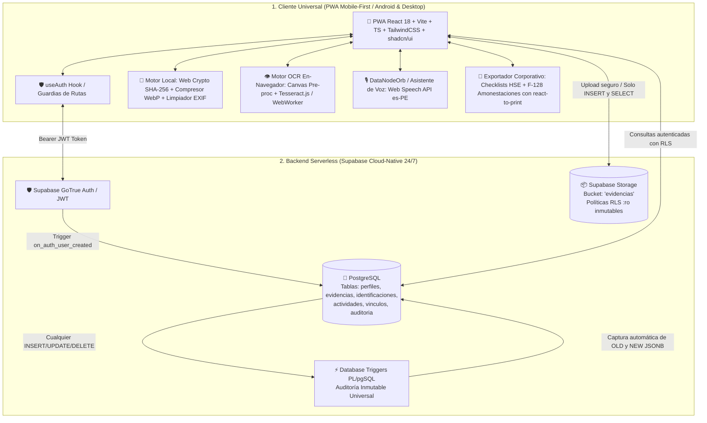
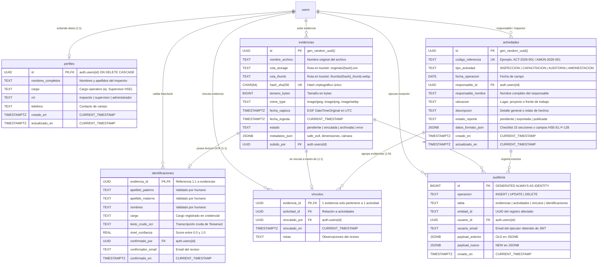
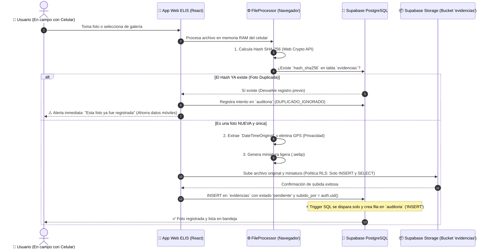
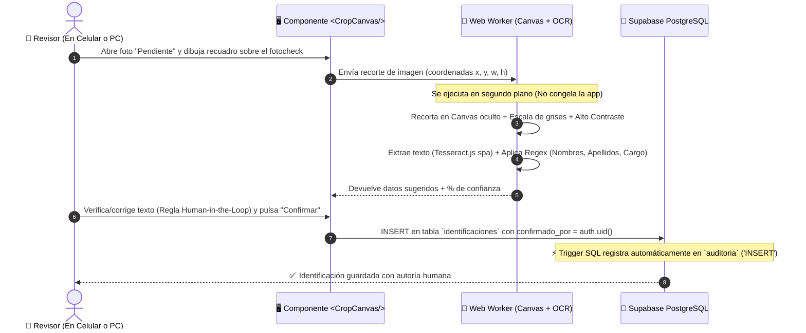
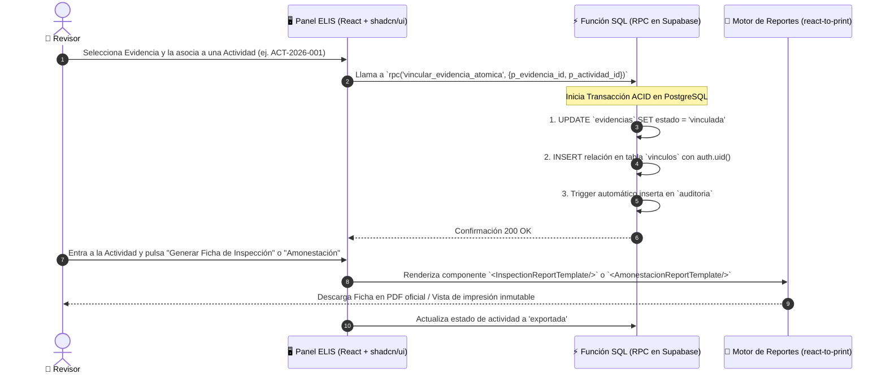

# ELIS 5.0 — Especificación Técnica, Arquitectura y Guía de Desarrollo Unificada

> **Documento Maestro de Arquitectura y Requerimientos de Software (SRS/SAD) — Edición Cloud-Native (Zero-Docker / Free-Tier)**  
> **Versión:** 5.2.0-ENTERPRISE-AUTH-HSE (Sincronización Total con Base de Datos, Shadcn UI, Formatos Corporativos HSE y Single Source of Truth)  
> **Clasificación:** Confidencial / Repositorio Privado  
> **Estado:** Documento de Especificación Activo para Producción (Única Fuente de Verdad Oficial)  

---

## 1. Visión, Objetivos y Principios Rectores

### 1.1 Propósito y Problema de Negocio
En operaciones de campo, supervisión técnica, evaluaciones e inspecciones de Seguridad, Salud en el Trabajo y Medio Ambiente (HSE/SST), los registros operativos (fotografías de inspecciones, credenciales/fotochecks, checklists de 15 secciones y registros de amonestación disciplinaria) suelen dispersarse en múltiples canales no controlados (galerías de teléfonos personales, chats de mensajería instantánea, carpetas locales y hojas de cálculo no estandarizadas).

Esto genera:
* **Pérdida de trazabilidad y cadena de custodia:** No hay certeza del momento de captura ni del autor autenticado.
* **Duplicación masiva de archivos:** Archivos idénticos guardados en diferentes carpetas consumen almacenamiento innecesario.
* **Riesgo de asociaciones erróneas:** Asignación de evidencias a inspecciones o trabajadores equivocados sin validación humana.
* **Cargas operativas manuales y lentas:** Compilación manual de minutas, reportes rígidos y dependientes de ecosistemas propietarios (como OneNote/Azure AD) que caducan y no permiten control visual.
* **Sobrecarga de hardware local:** Obligar a una laptop a mantenerse encendida procesando Docker, n8n o esperando que archivos sincronicen por carpetas locales consume RAM y batería de forma ineficiente.

**ELIS (Entorno Local Inteligente y Seguro) 5.0 Cloud-Native** elimina por completo la dependencia de tener una laptop encendida con Docker, SQLite, n8n, OneDrive y OneNote. Todo se transforma en una arquitectura **Serverless / Cloud-Native** centrada en una **PWA (Progressive Web App)** en React + TypeScript y respaldada por **Supabase (PostgreSQL + Storage + Auth)**:
* **Subida directa desde el navegador móvil** hacia el bucket unificado `evidencias` en Supabase Storage.
* **Cálculo criptográfico en el cliente** (Web Crypto API SHA-256 en milisegundos en el celular).
* **Base de datos Postgres gestionada 24/7 (Supabase)** con políticas RLS inmutables y triggers automáticos de auditoría.
* **Autenticación Corporativa Supabase Auth:** Control de acceso basado en identidad JWT, vinculación estricta con `public.perfiles` y bloqueo categórico a peticiones anónimas (`anon`).
* **Generación nativa de Fichas Técnicas, Checklists HSE y Registro de Amonestación HSE-EL-F-128** en React con control estético del 100%, eliminando la dependencia rígida de Microsoft OneNote y Graph API.
* **Asistente de Voz Interactivo (Orbe):** Componente háptico y visual con Web Speech API (`es-PE`) para dictado ágil de hallazgos en campo.
* **Cero consumo ocioso de RAM en tu equipo ($0 costo en capas gratuitas).**



---

### 1.2 Principios Éticos y Reglas de Negocio Inmutables

Cualquier implementación del código debe apegarse estrictamente a las siguientes 5 reglas inmutables:

1. **Gobernanza "Human-in-the-Loop" Obligatoria:**  
   ELIS **no infiere ni inventa inspecciones**. Jamás asocia automáticamente una foto a un operario o a una infracción basándose únicamente en similitud visual o cercanía temporal. Toda vinculación requiere confirmación explícita de un revisor humano registrado con su `auth.uid()`.
2. **Prohibición Total de Reconocimiento Facial / Biometría:**  
   ELIS **no realiza detección ni reconocimiento facial**. El módulo de fotochecks extrae exclusivamente texto impreso en credenciales mediante OCR guiado por un recorte manual del usuario.
3. **Integridad Absoluta de Evidencias Originales (`:ro` vía RLS):**  
   En Supabase Storage (bucket `evidencias`) y en la tabla `public.evidencias` se configuran políticas estrictas donde los clientes solo tienen permisos de `INSERT` y `SELECT`, pero **jamás `UPDATE` ni `DELETE`**. Una vez subida la evidencia original, el archivo es inmutable.
4. **Auditoría Transaccional e Inmutable por Trigger:**  
   En lugar de depender exclusivamente de auditorías manuales en frontend, la base de datos PostgreSQL ejecuta el trigger `fn_registrar_auditoria_universal` a nivel de motor. Toda mutación guarda de forma ineludible el estado previo (`OLD`) y posterior (`NEW`) en `public.auditoria` registrando atómicamente el `auth.uid()`.
5. **Deduplicación Criptográfica en Cliente y Base de Datos:**  
   Antes de subir cualquier archivo, el cliente calcula el SHA-256 usando la **Web Crypto API** (`crypto.subtle.digest`). La columna `hash_sha256` en PostgreSQL tiene restricción `UNIQUE`, rechazando al instante cualquier evidencia repetida sin consumir ancho de banda de subida innecesario.

---

## 2. Pila Tecnológica Cloud-Native, Herramientas Open Source y MCP ($0 Costo)

### 2.1 Herramientas y Librerías Gratuitas (Open Source) en el Cliente
Para reemplazar por completo librerías pesadas y entornos de fondo (OpenCV, Pillow, Jinja2, Docker) por código puro en el navegador que corre en milisegundos en tu teléfono celular Android o PC sin costo:

| Necesidad del Proyecto | Librería Gratuita (GitHub / NPM) | Justificación Técnica y Beneficio para ELIS |
|---|---|---|
| **Diseño y Componentes UI Base** | `shadcn/ui` + `lucide-react` | Ecosistema atómico, accesible (Radix UI), con soporte completo de tema oscuro/claro y componentes robustos (`Sidebar`, `Table`, `Badge`, `Card`, `Dialog`). |
| **Recorte Interactivo de Fotochecks** | `react-easy-crop` / `react-image-crop` | Súper ligeras, soportan gestos táctiles de zoom con dos dedos (*pinch-to-zoom*) en pantalla móvil y entregan coordenadas normalizadas `{ x, y, width, height }`. |
| **Motor OCR sin Servidor** | `tesseract.js` (v5+) | Ejecuta Tesseract 5 directamente en un **Web Worker** del navegador. Descarga el modelo de idioma español (`spa`) una sola vez en caché y no consume memoria de servidor. |
| **Lectura y Limpieza EXIF + WebP** | `exifr` + `browser-image-compression` | `exifr` es la librería más veloz en JS para extraer `DateTimeOriginal` en milisegundos. `browser-image-compression` convierte la foto a `.webp` en memoria y descarta metadatos sensibles (GPS). |
| **Cálculo de Hash SHA-256** | **Web Crypto API** (`crypto.subtle`) | Nativo de todos los navegadores modernos. Cero dependencias adicionales; calcula el hash de una foto de 5 MB en menos de 0.1s. |
| **Generador de Fichas (Adiós OneNote)** | `react-to-print` / `@react-pdf/renderer` | Permite diseñar Checklists HSE y Formatos de Amonestación con Tailwind CSS y componentes React nativos, exportando a PDF oficial de alta resolución o formato imprimible en 1 clic. |
| **Instalación como App Móvil (PWA)** | `vite-plugin-pwa` | Convierte la web en una aplicación instalable en Android con soporte offline de assets, ícono en la pantalla de inicio y acceso a cámara. |
| **Cliente de Datos y Auth** | `@supabase/supabase-js` | Cliente universal con autenticación persistente, consultas tipadas y manejo directo de subidas a Storage. |
| **Animación Háptica / Visual Orbe** | `framer-motion` | Micro-animaciones esféricas reactivas para el componente `<DataNodeOrb />`. |

---

### 2.2 Servidores MCP para Antigravity (100% Gratuitos y Locales)
Para este stack Cloud-Native, Antigravity opera con 2 servidores MCP complementarios:

1. **Graphify MCP Server (`graphify`):**
   * **Rol:** Mapea el proyecto en TypeScript y React. Garantiza que cuando el agente cree una vista o función, reutilice obligatoriamente `BaseSupabaseService<T>` y los componentes UI atómicos de shadcn/ui sin duplicar código.
2. **Supabase MCP Server (`@supabase/mcp-server-supabase`):**
   * **Rol:** Sustituye al MCP de SQLite local. Conecta Antigravity directamente a tu proyecto de Supabase en la nube. Permite al agente inspeccionar esquemas, validar políticas RLS y ejecutar funciones SQL / RPC directamente desde el editor.

---

### 2.3 Matriz Comparativa: Stack Antiguo vs. Stack Cloud-Native

| Componente | Solución Tradicional (Obsoleta) | Nueva Solución ELIS 5.0 Cloud-Native | Justificación Técnica y Beneficio |
|---|---|---|---|
| **Base de Datos & Auth** | SQLite Local + Auth manual | **Supabase (PostgreSQL 15+ & GoTrue Auth & RLS)** | Accesible 24/7 desde el celular sin depender de que la PC esté prendida. Políticas RLS granulares, tabla perfiles y Triggers automáticos. |
| **Ingesta de Evidencias** | FolderSync + OneDrive + FileWatcher local | **React PWA + Web Crypto API + Direct Storage Upload** | Captura directa desde la cámara del celular. SHA-256 instantáneo en cliente; verificación de duplicados previa a la subida. |
| **Almacenamiento de Fotos** | Disco local Windows + OneDrive | **Supabase Storage (`evidencias`)** | 1 GB gratis en Supabase (~3,000 fotos WebP) con regla `:ro` inmutable. Acceso seguro por URLs autenticadas. |
| **Generación de Fichas** | OneNote vía Microsoft Graph API | **Módulo React + Generador PDF (`react-to-print`)** | Elimina tokens caducados de Azure AD y plantillas HTML rígidas. Control estético total en Tailwind con formato oficial HSE-EL-F-128 e historial de auditoría. |
| **Motor OCR** | OpenCV + Tesseract en PC (pesado) | **Tesseract.js (Web Worker en Navegador)** | Ejecuta el OCR en un hilo secundario sin congelar la app, consumiendo CPU del dispositivo cliente únicamente durante los 2 segundos de extracción. |
| **Automatización y Tareas** | n8n en contenedor Docker local | **PostgreSQL Triggers & Funciones RPC** | Cero consumo de RAM de fondo. Trazabilidad garantizada por triggers a nivel de base de datos. |
| **Frontend Móvil y Web** | SPA tradicional en localhost | **PWA (`vite-plugin-pwa` + React 18 + TS + Tailwind + shadcn/ui)** | Instalable en Android/iOS como aplicación nativa, soporte offline parcial y acceso directo a la cámara. |
| **Gobernanza de Código** | Desarrollo disperso sin verificación | **Antigravity + Graphify + Supabase MCP** | Reglas de arquitectura inyectadas, verificación automática de servicios base y navegación viva del AST/código. |

---

### 2.4 Ecosistema de Agentes, Cursor Rules y Skills Especializadas
Para mantener un desarrollo estructurado, limpio y sin degradación de contexto, el comportamiento de los asistentes (Antigravity y Cursor) se rige por un catálogo modular de reglas:

1. **Estructura en `.agents/rules/` y `.cursor/rules/`:**
   * `01-elis-core-rules.md`: Reglas inmutables de negocio (protección del bucket `:ro`, gobernanza *Human-in-the-Loop*, deduplicación SHA-256 obligatoria y consulta previa a Graphify).
   * `02-backend-reusability.md`: Patrones TypeScript POO (`BaseSupabaseService<T>`) y operaciones atómicas multi-tabla delegadas a funciones `RPC`.
   * `03-frontend-components.md`: PWA Mobile-First, componentes shadcn/ui (`@/components/ui/`), Web Workers para OCR y `@supabase/supabase-js`.
   * `04-supabase-postgres-best-practices.md`: Seguridad RLS (`TO authenticated`, sin `auth.role()`), `SECURITY DEFINER` en triggers de auditoría e indexación eficiente.
   * `graphify.md`: Verificación automática del grafo de conocimiento antes de crear código nuevo.

2. **Skills y Reglas de Repositorios Especializados:**
   * **`nextjs-supabase` / `react-supabase`:** Buenas prácticas de consumo de `@supabase/supabase-js`, manejo de sesiones reactivas y tipado estricto.
   * **`supabase-postgres-best-practices`:** Guías oficiales de optimización de Postgres, consultas no bloqueantes y seguridad de políticas RLS.
   * **`typescript-clean-code` & `tailwindcss-ui-patterns`:** Código limpio, desacoplamiento en Custom Hooks y diseño visual moderno.

---

## 3. Modelo de Datos Relacional y Auditoría Inmutable (PostgreSQL / Supabase)

### 3.1 Diagrama de Entidad-Relación (Alineado con database.types.ts y public.perfiles)



---

### 3.2 Script DDL y Trigger Inmutable de Auditoría en PostgreSQL (Normalizado)

```sql
-- ==============================================================================
-- PROYECTO: ELIS 5.0 Cloud-Native (Base de Datos en Supabase)
-- DESCRIPCIÓN: Modelo Relacional Normalizado, Perfiles, Auditoría y RPC Atómica
-- ==============================================================================

-- 0. EXTENSIÓN PARA CRIPTOGRAFÍA Y UUIDs
CREATE EXTENSION IF NOT EXISTS "pgcrypto";

-- 1. TABLA DE PERFILES DE INSPECTORES (Vinculada 1:1 a auth.users)
CREATE TABLE IF NOT EXISTS public.perfiles (
    id UUID PRIMARY KEY REFERENCES auth.users(id) ON DELETE CASCADE,
    nombres_completos TEXT NOT NULL,
    cargo TEXT NOT NULL DEFAULT 'Inspector HSE',
    rol TEXT NOT NULL DEFAULT 'inspector' CHECK (rol IN ('inspector', 'supervisor', 'administrador')),
    telefono TEXT,
    creado_en TIMESTAMPTZ NOT NULL DEFAULT now(),
    actualizado_en TIMESTAMPTZ NOT NULL DEFAULT now()
);

-- Trigger de aprovisionamiento automático de perfiles
CREATE OR REPLACE FUNCTION public.handle_new_user()
RETURNS TRIGGER AS $$
BEGIN
    INSERT INTO public.perfiles (id, nombres_completos, cargo, rol)
    VALUES (
        NEW.id,
        COALESCE(NEW.raw_user_meta_data->>'nombres_completos', split_part(NEW.email, '@', 1)),
        COALESCE(NEW.raw_user_meta_data->>'cargo', 'Inspector HSE'),
        COALESCE(NEW.raw_user_meta_data->>'rol', 'inspector')
    )
    ON CONFLICT (id) DO NOTHING;
    RETURN NEW;
END;
$$ LANGUAGE plpgsql SECURITY DEFINER;

DROP TRIGGER IF EXISTS trg_on_auth_user_created ON auth.users;
CREATE TRIGGER trg_on_auth_user_created
    AFTER INSERT ON auth.users
    FOR EACH ROW EXECUTE FUNCTION public.handle_new_user();

-- 2. TABLA DE EVIDENCIAS (Inmutable por diseño y deduplicada)
CREATE TABLE IF NOT EXISTS public.evidencias (
    id UUID PRIMARY KEY DEFAULT gen_random_uuid(),
    nombre_archivo TEXT NOT NULL,
    ruta_storage TEXT NOT NULL,
    ruta_thumb TEXT,
    hash_sha256 CHAR(64) NOT NULL UNIQUE,
    tamano_bytes BIGINT NOT NULL,
    mime_type TEXT NOT NULL,
    fecha_captura TIMESTAMPTZ,
    fecha_ingesta TIMESTAMPTZ NOT NULL DEFAULT now(),
    estado TEXT NOT NULL DEFAULT 'pendiente' 
        CHECK (estado IN ('pendiente', 'vinculada', 'archivada', 'error')),
    metadatos_json JSONB DEFAULT '{}'::jsonb,
    subido_por UUID REFERENCES auth.users(id) ON DELETE SET NULL
);

-- 3. TABLA DE IDENTIFICACIONES (OCR validado por humano 1:1)
CREATE TABLE IF NOT EXISTS public.identificaciones (
    evidencia_id UUID PRIMARY KEY REFERENCES public.evidencias(id) ON DELETE RESTRICT,
    apellido_paterno TEXT NOT NULL,
    apellido_materno TEXT NOT NULL,
    nombres TEXT NOT NULL,
    cargo TEXT,
    texto_crudo_ocr TEXT,
    nivel_confianza REAL CHECK (nivel_confianza >= 0.0 AND nivel_confianza <= 1.0),
    confirmado_por UUID REFERENCES auth.users(id) ON DELETE SET NULL,
    confirmador_email TEXT,
    confirmado_en TIMESTAMPTZ NOT NULL DEFAULT now()
);

-- 4. TABLA DE ACTIVIDADES (Inspecciones, Auditorías y Amonestaciones con Formatos Corporativos)
CREATE TABLE IF NOT EXISTS public.actividades (
    id UUID PRIMARY KEY DEFAULT gen_random_uuid(),
    codigo_referencia TEXT NOT NULL UNIQUE,
    tipo_actividad TEXT NOT NULL 
        CHECK (tipo_actividad IN ('INSPECCION', 'CAPACITACION', 'AUDITORIA', 'AMONESTACION')),
    fecha_operacion DATE NOT NULL,
    responsable_id UUID REFERENCES auth.users(id) ON DELETE SET NULL,
    responsable_nombre TEXT NOT NULL,
    ubicacion TEXT NOT NULL,
    descripcion TEXT,
    estado_reporte TEXT NOT NULL DEFAULT 'pendiente' 
        CHECK (estado_reporte IN ('pendiente', 'exportada', 'publicada')),
    datos_formato_json JSONB DEFAULT '{}'::jsonb,
    creado_en TIMESTAMPTZ NOT NULL DEFAULT now(),
    actualizado_en TIMESTAMPTZ NOT NULL DEFAULT now()
);

-- 5. TABLA DE VÍNCULOS (Garantiza 1 evidencia = 1 actividad)
CREATE TABLE IF NOT EXISTS public.vinculos (
    evidencia_id UUID PRIMARY KEY REFERENCES public.evidencias(id) ON DELETE RESTRICT,
    actividad_id UUID NOT NULL REFERENCES public.actividades(id) ON DELETE RESTRICT,
    vinculado_por UUID REFERENCES auth.users(id) ON DELETE SET NULL,
    vinculado_en TIMESTAMPTZ NOT NULL DEFAULT now(),
    notas TEXT
);

-- 6. TABLA DE AUDITORÍA UNIVERSAL E INMUTABLE
CREATE TABLE IF NOT EXISTS public.auditoria (
    id BIGINT GENERATED ALWAYS AS IDENTITY PRIMARY KEY,
    operacion TEXT NOT NULL,   -- INSERT, UPDATE, DELETE
    tabla TEXT NOT NULL,       -- evidencias, actividades, vinculos, identificaciones, perfiles
    entidad_id TEXT NOT NULL,  -- UUID del registro afectado
    usuario_id UUID REFERENCES auth.users(id) ON DELETE SET NULL,
    usuario_email TEXT DEFAULT COALESCE(current_setting('request.jwt.claims', true)::json->>'email', 'sistema'),
    payload_anterior JSONB,
    payload_nuevo JSONB,
    creado_en TIMESTAMPTZ NOT NULL DEFAULT now()
);

-- 7. ÍNDICES DE ALTA VELOCIDAD
CREATE INDEX IF NOT EXISTS idx_evidencias_estado ON public.evidencias(estado);
CREATE INDEX IF NOT EXISTS idx_evidencias_fecha ON public.evidencias(fecha_ingesta DESC);
CREATE INDEX IF NOT EXISTS idx_evidencias_subido_por ON public.evidencias(subido_por);
CREATE INDEX IF NOT EXISTS idx_vinculos_actividad ON public.vinculos(actividad_id);
CREATE INDEX IF NOT EXISTS idx_actividades_responsable ON public.actividades(responsable_id);
CREATE INDEX IF NOT EXISTS idx_auditoria_entidad ON public.auditoria(tabla, entidad_id);
CREATE INDEX IF NOT EXISTS idx_auditoria_fecha ON public.auditoria(creado_en DESC);

-- 8. TRIGGER UNIVERSAL DE AUDITORÍA AUTOMÁTICA
CREATE OR REPLACE FUNCTION public.fn_registrar_auditoria_universal() 
RETURNS TRIGGER AS $$ 
DECLARE
    v_id TEXT;
    v_user_id UUID;
    v_user_email TEXT;
BEGIN 
    IF (TG_TABLE_NAME = 'vinculos' OR TG_TABLE_NAME = 'identificaciones' OR TG_TABLE_NAME = 'perfiles') THEN
        v_id := COALESCE(NEW.id::TEXT, NEW.evidencia_id::TEXT, OLD.id::TEXT, OLD.evidencia_id::TEXT);
    ELSE
        v_id := COALESCE(NEW.id::TEXT, OLD.id::TEXT);
    END IF;

    BEGIN
        v_user_id := auth.uid();
    EXCEPTION WHEN OTHERS THEN
        v_user_id := NULL;
    END;

    BEGIN
        v_user_email := COALESCE(current_setting('request.jwt.claims', true)::json->>'email', 'sistema');
    EXCEPTION WHEN OTHERS THEN
        v_user_email := 'sistema';
    END;

    IF (TG_OP = 'INSERT') THEN 
        INSERT INTO public.auditoria (operacion, tabla, entidad_id, usuario_id, usuario_email, payload_anterior, payload_nuevo)
        VALUES ('INSERT', TG_TABLE_NAME, v_id, v_user_id, v_user_email, NULL, to_jsonb(NEW));
        RETURN NEW;
    ELSIF (TG_OP = 'UPDATE') THEN 
        INSERT INTO public.auditoria (operacion, tabla, entidad_id, usuario_id, usuario_email, payload_anterior, payload_nuevo)
        VALUES ('UPDATE', TG_TABLE_NAME, v_id, v_user_id, v_user_email, to_jsonb(OLD), to_jsonb(NEW));
        RETURN NEW;
    ELSIF (TG_OP = 'DELETE') THEN 
        INSERT INTO public.auditoria (operacion, tabla, entidad_id, usuario_id, usuario_email, payload_anterior, payload_nuevo)
        VALUES ('DELETE', TG_TABLE_NAME, v_id, v_user_id, v_user_email, to_jsonb(OLD), NULL);
        RETURN OLD;
    END IF;
    RETURN NULL; 
END; 
$$ LANGUAGE plpgsql SECURITY DEFINER;

-- Disparadores automáticos en todas las tablas operativas
DROP TRIGGER IF EXISTS trg_audit_evidencias ON public.evidencias;
CREATE TRIGGER trg_audit_evidencias AFTER INSERT OR UPDATE OR DELETE ON public.evidencias FOR EACH ROW EXECUTE FUNCTION public.fn_registrar_auditoria_universal();

DROP TRIGGER IF EXISTS trg_audit_actividades ON public.actividades;
CREATE TRIGGER trg_audit_actividades AFTER INSERT OR UPDATE OR DELETE ON public.actividades FOR EACH ROW EXECUTE FUNCTION public.fn_registrar_auditoria_universal();

DROP TRIGGER IF EXISTS trg_audit_identificaciones ON public.identificaciones;
CREATE TRIGGER trg_audit_identificaciones AFTER INSERT OR UPDATE OR DELETE ON public.identificaciones FOR EACH ROW EXECUTE FUNCTION public.fn_registrar_auditoria_universal();

DROP TRIGGER IF EXISTS trg_audit_vinculos ON public.vinculos;
CREATE TRIGGER trg_audit_vinculos AFTER INSERT OR UPDATE OR DELETE ON public.vinculos FOR EACH ROW EXECUTE FUNCTION public.fn_registrar_auditoria_universal();

-- 9. FUNCIÓN RPC PARA VINCULACIÓN ATÓMICA
CREATE OR REPLACE FUNCTION public.vincular_evidencia_atomica( 
    p_evidencia_id UUID, 
    p_actividad_id UUID, 
    p_notas TEXT DEFAULT NULL 
) 
RETURNS BOOLEAN AS $$ 
BEGIN 
    UPDATE public.evidencias 
    SET estado = 'vinculada' 
    WHERE id = p_evidencia_id; 

    INSERT INTO public.vinculos (evidencia_id, actividad_id, vinculado_por, notas) 
    VALUES (p_evidencia_id, p_actividad_id, auth.uid(), p_notas) 
    ON CONFLICT (evidencia_id) DO UPDATE 
    SET actividad_id = EXCLUDED.actividad_id, 
        vinculado_por = auth.uid(), 
        notas = EXCLUDED.notas, 
        vinculado_en = now(); 

    RETURN TRUE; 
END; 
$$ LANGUAGE plpgsql SECURITY DEFINER;

-- 10. FUNCIÓN RPC ATÓMICA PARA GUARDADO INTEGRAL DE ACTIVIDADES Y FORMATOS HSE
CREATE OR REPLACE FUNCTION public.guardar_actividad_hse_completa(
    p_id UUID DEFAULT NULL,
    p_datos_generales JSONB DEFAULT '{}'::jsonb,
    p_datos_formato_json JSONB DEFAULT '{}'::jsonb,
    p_estado_reporte TEXT DEFAULT NULL
)
RETURNS JSONB AS $$
DECLARE
    v_id UUID;
    v_user_id UUID;
    v_actividad RECORD;
    v_codigo TEXT;
    v_tipo TEXT;
    v_fecha DATE;
    v_responsable_nombre TEXT;
    v_ubicacion TEXT;
    v_descripcion TEXT;
    v_estado TEXT;
    v_formato JSONB;
BEGIN
    v_user_id := auth.uid();
    v_id := p_id;
    v_formato := COALESCE(p_datos_formato_json, '{}'::jsonb);

    v_codigo := NULLIF(TRIM(p_datos_generales->>'codigo_referencia'), '');
    v_tipo := NULLIF(TRIM(p_datos_generales->>'tipo_actividad'), '');
    v_fecha := (p_datos_generales->>'fecha_operacion')::DATE;
    v_responsable_nombre := NULLIF(TRIM(p_datos_generales->>'responsable_nombre'), '');
    v_ubicacion := NULLIF(TRIM(p_datos_generales->>'ubicacion'), '');
    v_descripcion := p_datos_generales->>'descripcion';
    v_estado := COALESCE(p_estado_reporte, p_datos_generales->>'estado_reporte', 'pendiente');

    IF v_id IS NOT NULL THEN
        UPDATE public.actividades
        SET 
            codigo_referencia = COALESCE(v_codigo, codigo_referencia),
            tipo_actividad = COALESCE(v_tipo, tipo_actividad),
            fecha_operacion = COALESCE(v_fecha, fecha_operacion),
            responsable_id = COALESCE(responsable_id, v_user_id),
            responsable_nombre = COALESCE(v_responsable_nombre, responsable_nombre),
            ubicacion = COALESCE(v_ubicacion, ubicacion),
            descripcion = CASE 
                WHEN p_datos_generales ? 'descripcion' THEN v_descripcion 
                ELSE descripcion 
            END,
            estado_reporte = COALESCE(v_estado, estado_reporte),
            datos_formato_json = v_formato,
            actualizado_en = now()
        WHERE id = v_id
        RETURNING * INTO v_actividad;

        IF NOT FOUND THEN
            RAISE EXCEPTION 'Actividad con ID % no encontrada para actualizar.', v_id;
        END IF;
    ELSE
        IF v_codigo IS NULL THEN
            RAISE EXCEPTION 'El código de referencia es obligatorio para crear una actividad.';
        END IF;

        INSERT INTO public.actividades (
            codigo_referencia,
            tipo_actividad,
            fecha_operacion,
            responsable_id,
            responsable_nombre,
            ubicacion,
            descripcion,
            estado_reporte,
            datos_formato_json,
            creado_en,
            actualizado_en
        )
        VALUES (
            v_codigo,
            COALESCE(v_tipo, 'INSPECCION'),
            COALESCE(v_fecha, CURRENT_DATE),
            v_user_id,
            COALESCE(v_responsable_nombre, 'Inspector HSE'),
            COALESCE(v_ubicacion, 'Área de Operaciones'),
            v_descripcion,
            COALESCE(v_estado, 'pendiente'),
            v_formato,
            now(),
            now()
        )
        ON CONFLICT (codigo_referencia) DO UPDATE
        SET 
            tipo_actividad = EXCLUDED.tipo_actividad,
            fecha_operacion = EXCLUDED.fecha_operacion,
            responsable_id = COALESCE(public.actividades.responsable_id, EXCLUDED.responsable_id),
            responsable_nombre = EXCLUDED.responsable_nombre,
            ubicacion = EXCLUDED.ubicacion,
            descripcion = EXCLUDED.descripcion,
            estado_reporte = EXCLUDED.estado_reporte,
            datos_formato_json = EXCLUDED.datos_formato_json,
            actualizado_en = now()
        RETURNING * INTO v_actividad;
    END IF;

    RETURN to_jsonb(v_actividad);
END;
$$ LANGUAGE plpgsql SECURITY DEFINER SET search_path = public;
```

---

## 4. Arquitectura de Seguridad (Supabase Auth + Perfiles + Matriz RLS)

### 4.1 Flujo de Autenticación y Tabla `public.perfiles`
1. El usuario inicia sesión en la pantalla `<LoginPage />` mediante correo corporativo y contraseña con `supabase.auth.signInWithPassword()`.
2. Supabase GoTrue expide un par de tokens JWT (`access_token` y `refresh_token`) almacenados de forma segura en `localStorage` por `@supabase/supabase-js`.
3. Cada usuario registrado en `auth.users` posee un registro espejo en `public.perfiles`. El trigger en PostgreSQL `trg_on_auth_user_created` provisiona automáticamente el perfil inicial tras la confirmación de registro.

### 4.2 Matriz Exhaustiva de Políticas Row Level Security (RLS)

Siguiendo las mejores prácticas de Supabase (`04-supabase-postgres-best-practices.md`), se prohíbe el uso de la función obsoleta `auth.role()` y se aplica la cláusula moderna `TO authenticated` combinada con predicados de propiedad en `USING` y `WITH CHECK`. Se bloquea de forma absoluta cualquier operación al rol `anon`.

| Objeto / Tabla | SELECT | INSERT | UPDATE | DELETE | Justificación de Negocio / Regla Inmutable |
|---|:---:|:---:|:---:|:---:|---|
| **`public.perfiles`** | `TO authenticated` (Todos pueden ver inspectores) | `TO authenticated` (`id = (select auth.uid())`) | `TO authenticated` (`id = (select auth.uid())`) | ❌ **PROHIBIDO** | Los usuarios solo gestionan su propio perfil. No se permite eliminar perfiles desde cliente. |
| **`public.evidencias`** | `TO authenticated` (Lectura compartida para auditoría) | `TO authenticated` (`subido_por = (select auth.uid())`) | `TO authenticated` (Solo cambio de estado `pendiente` -> `vinculada`) | ❌ **PROHIBIDO (:ro)** | **Regla Inmutable:** Prohibido borrar evidencias originales. Integridad de cadena de custodia. |
| **`public.identificaciones`** | `TO authenticated` | `TO authenticated` (`confirmado_por = (select auth.uid())`) | `TO authenticated` (`confirmado_por = (select auth.uid())`) | ❌ **PROHIBIDO** | La transcripción validada por un humano no puede ser eliminada. Solo corregida por el revisor. |
| **`public.actividades`** | `TO authenticated` | `TO authenticated` (`responsable_id IS NULL OR responsable_id = (select auth.uid())`) | `TO authenticated` (`responsable_id IS NULL OR responsable_id = (select auth.uid()) OR rol IN ('supervisor','administrador')`) | ❌ **PROHIBIDO** | Fichas e inspecciones no se borran; supervisores/administradores pueden auditar y actualizar cualquier actividad. |
| **`public.vinculos`** | `TO authenticated` | `TO authenticated` (`vinculado_por = (select auth.uid())`) | `TO authenticated` (`vinculado_por = (select auth.uid())`) | `TO authenticated` (Permite desvincular solo si estado vuelve a `pendiente`) | Desvincular una foto restaura su disponibilidad para reasignación en campo. |
| **`public.auditoria`** | `TO authenticated` (Solo lectura de trazabilidad) | ❌ **BLOQUEADO AL CLIENTE** (Solo vía Trigger `SECURITY DEFINER`) | ❌ **PROHIBIDO** | ❌ **PROHIBIDO** | **Inmutabilidad Absoluta:** La auditoría solo se escribe por triggers en PostgreSQL. Cero mutaciones manuales. |
| **Storage (`evidencias`)** | `TO authenticated` | `TO authenticated` (`(select auth.uid()) IS NOT NULL`) | ❌ **PROHIBIDO (:ro)** | ❌ **PROHIBIDO (:ro)** | Los archivos de imagen originales y miniaturas jamás pueden sobrescribirse o eliminarse. |

---

## 5. Soporte de Formatos Corporativos HSE en BD y Backend

Para responder a las exigencias operativas de campo, ELIS 5.0 amplía la tabla `public.actividades` para soportar tanto inspecciones con checklist exhaustivo como el registro disciplinario de amonestaciones:

### 5.1 Ampliación de la Columna `tipo_actividad`
La restricción `CHECK` de `tipo_actividad` se expande a:
```sql
ALTER TABLE public.actividades 
DROP CONSTRAINT IF EXISTS actividades_tipo_actividad_check;

ALTER TABLE public.actividades 
ADD CONSTRAINT actividades_tipo_actividad_check 
CHECK (tipo_actividad IN ('INSPECCION', 'CAPACITACION', 'AUDITORIA', 'AMONESTACION'));
```

### 5.2 Estructura JSONB del Campo `datos_formato_json`
Se añade la columna `datos_formato_json JSONB DEFAULT '{}'::jsonb` a `public.actividades`.

#### A. Formato de Inspección HSE (Checklist de 15 Secciones S / ER / PI / NA)
Contiene la evaluación de las 15 áreas normativas de seguridad observadas en el documento de supervisión:
1. `instalacion_estructura_almacen` (1.1 al 1.3: suelos, paredes, ventanas)
2. `herramientas_manuales_electricas`
3. `escaleras_andamios`
4. `equipos_proteccion_personal_epp`
5. `orden_limpieza`
6. `instalaciones_electricas`
7. `proteccion_contra_incendios`
8. `productos_quimicos`
9. `procedimientos_trabajo_seguro`
10. `ergonomia_manipulacion_cargas`
11. `medio_ambiente_residuos`
12. `vehiculos_maquinaria_pesada`
13. `primeros_auxilios_emergencias`
14. `capacitacion_charlas_seguridad`
15. `comportamiento_observacion_preventiva`

Cada ítem registra su calificación (`S: Seguro`, `ER: En Riesgo`, `PI: Peligro Inminente`, `NA: No Aplica`) y las observaciones/medidas correctivas inmediatas.

#### B. Formato de Registro de Amonestación (HSE-EL-F-128)
Estructurado directamente a partir del formato oficial:
* **Datos del Amonestado:** Apellidos y nombres, DNI, cargo, empresa contratista/subcontratista, ubicación, fecha y hora.
* **Supervisores Responsables:** Capataz o jefe de cuadrilla, ingeniero responsable, actividad en ejecución.
* **Motivo de Amonestación (Marcar con X):**
  - `01`: Falta de HSE (según RIIST PA)
  - `02`: Acto Subestándar
  - `03`: Observación HSE
  - `04`: Condición Subestándar
  - `detalle_motivo`: Texto descriptivo detallado.
* **Nivel de Riesgo:** `01 Intolerable`, `02 Bajo`, `03 Moderado`, `04 Otro`.
* **Acción Inmediata de los Hechos:** Medidas adoptadas en el sitio de la infracción.
* **Sanción Aplicada según RISST:**
  - `01`: Llamada de atención
  - `02`: Suspensión de X días
  - `03`: Retiro inmediato del trabajador
  - `04`: Otro
* **Validación del Registro:** Firmas/nombres de Realizado por (Inspector HSE), Aprobado por (Ing. Residente/Jefe HSE) y Aceptado por (Trabajador amonestado).

### 5.3 Conexión con el Asistente de Voz (Orbe)
El asistente interactivo `<DataNodeOrb />` se conecta mediante Web Speech API (`lang: 'es-PE'`) y comandos de voz para:
- Dictar el **Relato breve de la razón de la amonestación** o la **Acción inmediata**.
- Llenar ítems del checklist de inspección indicando voz alta: *"Sección cuatro EPP, botas de seguridad en riesgo"*.
- Feedback visual con efectos de brillo y partículas reactivas al volumen de voz usando Framer Motion.

---

## 6. Arquitectura de Software, Capas y Flujos Operativos

### 6.1 Arquitectura por Capas Limpias (Para Antigravity y Graphify)

```text
┌────────────────────────────────────────────────────────────────────────┐
│ 1. CAPA DE PRESENTACIÓN UI (React + shadcn/ui + TailwindCSS)           │
│  - Guardias: <ProtectedRoute />, <LoginPage />                         │
│  - Shell: <DashboardLayout />, <AppSidebar />                          │
│  - Páginas: InboxEvidences, ActivitiesManager, ActivityDetail          │
│  - Modales: OcrResultEditor, Formulario Amonestación, Selector Vínculos│
│  - Asistente: <DataNodeOrb /> con Web Speech API                       │
│  - Impresión: <InspectionReportTemplate />, <AmonestacionTemplate />   │
└───────────────────────────────────┬────────────────────────────────────┘
                                    │ Hooks Reactivos
┌───────────────────────────────────▼────────────────────────────────────┐
│ 2. CAPA DE ESTADO Y HOOKS (Lógica de Aplicación)                       │
│  - useAuth(): Manejo de sesión JWT, rol y perfil del inspector         │
│  - useEvidences(): Paginación, filtros de estado, inserción optimista  │
│  - useSpeech(): Captura y transcripción fonética en español de Perú    │
│  - FileProcessor & OcrWorker: Web Crypto SHA-256 + Tesseract.js Worker │
└───────────────────────────────────┬────────────────────────────────────┘
                                    │ Servicios Tipados POO
┌───────────────────────────────────▼────────────────────────────────────┐
│ 3. CAPA DE SERVICIOS Y DOMINIO (TypeScript POO)                        │
│  - BaseSupabaseService<T>: Inyección de auth.uid(), RLS error handler  │
│  - AuthService: signIn, signOut, getCurrentProfile                     │
│  - EvidenceService: uploadAndRegisterEvidence (bucket 'evidencias')    │
│  - ActivityService: vincularEvidenciaAtomica RPC, CRUD Formatos HSE    │
│  - OcrService: saveHumanValidation con confirmed_by = auth.uid()       │
└───────────────────────────────────┬────────────────────────────────────┘
                                    │ HTTPS + Supabase JS Client v2
┌───────────────────────────────────▼────────────────────────────────────┐
│ 4. CAPA DE PERSISTENCIA Y MOTOR CLOUD (Supabase Cloud-Native)          │
│  - PostgreSQL 15: perfiles, evidencias, identificaciones, actividades,  │
│                   vinculos, auditoria                                  │
│  - Storage Bucket: 'evidencias' (originals/ y thumbs/) con RLS :ro     │
│  - Triggers PL/pgSQL: fn_registrar_auditoria_universal (SECURITY DEFINER)│
│  - Procedimientos RPC: vincular_evidencia_atomica                      │
└────────────────────────────────────────────────────────────────────────┘
```

---

### 6.2 Flujos Operativos y Diagramas de Secuencia Cloud-Native

#### Flujo 1: Ingesta desde la Calle (Celular) y Deduplicación Instantánea


#### Flujo 2: OCR Interactivo de Fotochecks (En-Navegador con Web Worker)


#### Flujo 3: Vinculación Atómica y Exportación de Ficha (Transacción RPC y Reporte PDF)


---

### 6.3 Estructura de Directorios para Desarrollo (PWA Frontend con shadcn/ui)

```text
frontend/
├── public/
│   ├── manifest.json                  # Configuración PWA (instalable en Android)
│   └── sw.js                          # Service Worker para caché de assets
├── src/
│   ├── components/
│   │   ├── ui/                        # Componentes oficiales shadcn/ui
│   │   │   ├── badge.tsx              # Insignias estandarizadas
│   │   │   ├── button.tsx             # Botones con variantes de estilo
│   │   │   ├── card.tsx               # Contenedores estructurados
│   │   │   ├── dialog.tsx             # Diálogos modales accesibles
│   │   │   ├── input.tsx              # Campos de texto y números
│   │   │   ├── separator.tsx          # Separadores visuales
│   │   │   ├── sidebar.tsx            # Barra lateral colapsable
│   │   │   ├── table.tsx              # Tablas de datos responsivas
│   │   │   ├── StatusBadge.tsx        # Insignias de negocio
│   │   │   ├── AuditTimeline.tsx      # Historial dinámico desde public.auditoria
│   │   │   └── Modal.tsx
│   │   ├── layout/
│   │   │   ├── DashboardLayout.tsx    # Layout maestro con Header y Sidebar
│   │   │   └── ProtectedRoute.tsx     # Guardia de sesión de Supabase Auth
│   │   ├── app-sidebar.tsx            # Navegación y módulos operativos
│   │   ├── ocr/
│   │   │   ├── CropCanvas.tsx         # Canvas táctil con rotación y zoom para recorte
│   │   │   └── OcrResultEditor.tsx    # Formulario de confirmación humana
│   │   ├── voice/
│   │   │   └── DataNodeOrb.tsx        # Asistente visual esférico con Web Speech API
│   │   ├── evidence/
│   │   │   ├── EvidenceUploader.tsx   # Subida con drag&drop y acceso directo a cámara
│   │   │   ├── EvidenceGrid.tsx       # Galería virtualizada con miniaturas WebP
│   │   │   └── EvidenceCard.tsx
│   │   └── reports/
│   │       ├── InspectionReportTemplate.tsx # Checklist de 15 secciones S/ER/PI/NA
│   │       ├── AmonestacionReportTemplate.tsx # Formato oficial HSE-EL-F-128
│   │       └── PdfExporter.tsx        # Exportador react-to-print
│   ├── pages/
│   │   ├── LoginPage.tsx              # Inicio de sesión corporativo
│   │   ├── InboxEvidences.tsx         # Bandeja de evidencias pendientes
│   │   ├── ActivitiesManager.tsx      # Gestor de inspecciones y amonestaciones
│   │   └── ActivityDetail.tsx         # Detalle de actividad y vinculación
│   ├── services/
│   │   ├── supabaseClient.ts          # Inicializador Supabase con sesión persistente
│   │   ├── BaseSupabaseService.ts     # Servicio genérico tipado CRUD y paginación
│   │   ├── AuthService.ts             # Gestión de login, logout y perfiles
│   │   ├── EvidenceService.ts         # Métodos específicos para evidencias y storage
│   │   ├── ActivityService.ts         # Gestión de actividades, vínculos y formatos HSE
│   │   └── OcrService.ts              # Transcripción y confirmación humana
│   ├── utils/
│   │   ├── fileProcessor.ts           # Web Crypto SHA-256 + EXIF + Conversión a WebP
│   │   └── ocrClient.ts               # Tesseract.js / pipeline de reconocimiento
│   ├── hooks/
│   │   ├── useAuth.ts                 # Hook reactivo de sesión y usuario autenticado
│   │   ├── useEvidences.ts            # Hook con caché y mutaciones optimistas
│   │   ├── useActivities.ts           # Hook de actividades y vínculos
│   │   └── useSpeech.ts               # Web Speech API en es-PE
│   ├── types/
│   │   └── database.types.ts          # Tipos generados de Supabase PostgreSQL
│   ├── App.tsx
│   └── main.tsx
```

---

## 7. Plan de Refactorización Integral por Módulos (Hoja de Ruta)

Para mantener la estabilidad absoluta del sistema, la evolución de ELIS 5.0 se articula en 4 fases ejecutivas:

* **[EN PROGRESO] Módulo 7: Refactorización de Base de Datos y Seguridad RLS (Supabase Cloud)**
  - Creación de tabla `public.perfiles` con clave foránea a `auth.users(id)` y trigger `trg_on_auth_user_created`.
  - Ampliación de `public.actividades` (`tipo_actividad` ampliado a `AMONESTACION`, columna `datos_formato_json`).
  - Activación estricta de RLS en las 6 tablas y políticas `:ro` en el bucket `evidencias` bloqueando acceso anónimo.
* **[PENDIENTE] Módulo 8: Refactorización de Backend/Servicios y Flujo de Autenticación**
  - Regeneración de `database.types.ts` con el esquema en la nube actualizado.
  - Creación de `AuthService.ts` y hook reactivo `useAuth.ts`.
  - Refactorización de `BaseSupabaseService`, `EvidenceService`, `ActivityService` y `OcrService` para inyectar automáticamente `auth.uid()`, validar sesiones activas y atrapar errores RLS.
* **[PENDIENTE] Módulo 9: Refactorización de UI — Login Corporativo, Guardia de Rutas y Formatos HSE**
  - Creación de pantalla corporativa `<LoginPage />` con shadcn/ui.
  - Protección de rutas con `<ProtectedRoute />` en `App.tsx`.
  - Inserción de perfil de inspector activo y botón de Cerrar Sesión en `DashboardLayout.tsx` y `AppSidebar.tsx`.
  - Formularios y plantillas PDF para Inspección HSE (Checklist 15 secciones) y Registro de Amonestación (HSE-EL-F-128).
* **[PENDIENTE] Módulo 10: Asistente Interactivo Orbe (Voz) y Suite de Auditoría Integral**
  - Componente interactivo `<DataNodeOrb />` con animaciones Framer Motion y Web Speech API `es-PE`.
  - Integración de dictado directo en formularios de campo HSE.
  - Pruebas unitarias en Vitest para Auth, Servicios, Triggers de Auditoría y Flujos de Voz.
