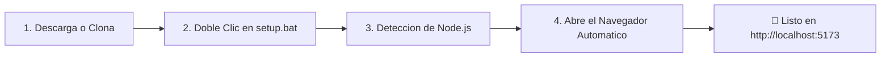

<div align="center">

# 🛡️ ELIS 5.0 — Entorno Local Inteligente y Seguro
### *Plataforma Cloud-Native para Gestión de Evidencias Forenses, Auditoría de Campo, OCR en Navegador y Generación de Fichas Técnicas HSE*

---

[](file:///d:/proyectos/ELIS/README.md)
[](file:///d:/proyectos/ELIS/ARQUITECTURA_Y_ESPECIFICACION_MODERNA.md)
[](file:///d:/proyectos/ELIS/README.md)

<br/>

[](https://react.dev/)
[](https://www.typescriptlang.org/)
[](https://vite.dev/)
[](https://tailwindcss.com/)
[](https://ui.shadcn.com/)
[](https://supabase.com/)
[](https://tesseract.projectnaptha.com/)
[](https://developer.mozilla.org/es/docs/Web/API/Web_Crypto_API)

</div>

---

## ⚡ Inicio Rápido en 1 Clic (Sin conocimientos de programación)

El sistema viene **completamente preconfigurado** con las credenciales públicas de Supabase para que cualquier persona en campo o en oficina pueda usarlo de inmediato en Windows.



### 📋 Pasos para el usuario final:
1. **Descarga el proyecto:** Clona con Git o haz clic en `Code -> Download ZIP` en GitHub y descomprime la carpeta.
2. **Ejecuta el asistente:** En la carpeta del proyecto, haz doble clic en el archivo:
   ```cmd
   setup.bat
   ```
   > 💡 **¿No tienes Node.js instalado?** No te preocupes: `setup.bat` lo detectará y **abrirá automáticamente la página oficial de Node.js** en tu navegador para que descargues el instalador gratuito recomendado con 1 clic.
3. **Navegador Automático:** El script descargará las librerías necesarias y **abrirá tu navegador automáticamente** en `http://localhost:5173`.
4. **Acceso desde el Celular:** Al estar expuesto en red con `--host`, podrás abrir la aplicación en el navegador de tu teléfono celular conectado a la misma red WiFi e instalarla como una app nativa (**PWA**).

---

## 🏗️ Resumen del Sistema y Módulos HSE

**ELIS 5.0** (*Entorno Local Inteligente y Seguro*) es una solución empresarial de alta confiabilidad que sustituye carpetas compartidas y canales no auditados por un flujo inmutable con garantías criptográficas:

```
ELIS 5.0 Core
├── 📸 Ingesta de Evidencias (Deduplicacion SHA-256 + Sanitizacion EXIF GPS)
├── 🪪 Reconocimiento OCR (Recorte react-easy-crop + Tesseract.js en Web Worker)
├── 📋 Gestor de Actividades (CRUD Reactivo + Dictado por Voz Web Speech es-PE)
├── 🛡️ Seguridad Inmutable (Supabase Storage S3 :ro + Postgres RLS + Triggers)
└── 📄 Fichas de Inspeccion (Plantillas corporativas exportables a PDF con react-to-print)
```

### 🔐 Pilares de Seguridad y Cumplimiento:
1. **Integridad Criptográfica en Origen:** Antes de transmitir cualquier imagen, el navegador calcula su huella digital **SHA-256** mediante la Web Crypto API (`crypto.subtle`). Si el archivo ya existe en Supabase, se rechaza de inmediato sin gastar ancho de banda móvil.
2. **Privacidad y Sanitización Forense:** Las fotos capturadas en campo conservan la fecha original (`DateTimeOriginal`), purgando completamente las coordenadas GPS y metadatos sensibles.
3. **Gobernanza Human-in-the-Loop:** El sistema **no inventa ni asigna automáticamente** faltas a operarios. Todo resultado de OCR y vinculación requiere validación visual de un supervisor humano registrado.
4. **Prohibición Total de Biometría:** Cumplimiento estricto de privacidad: se extrae texto de credenciales/fotochecks, sin reconocimiento facial.

---

## 💻 Pila Tecnológica Moderna

| Módulo / Capa | Tecnologías | Justificación Técnica |
|---|---|---|
| **Frontend Framework** | **React 19 + TypeScript** | Reactividad de última generación, tipado estricto y cero errores en tiempo de ejecución. |
| **Tooling & Build** | **Vite 8 + @tailwindcss/vite** | Compilación Rolldown ultrarrápida, HMR instantáneo y empaquetado optimizado. |
| **Sistema de Diseño** | **shadcn/ui + Tailwind CSS v4** | Interfaz limpia, accesible, corporativa (Sidebar, Table, Card, Dialog, Badge). |
| **Backend & Base de Datos** | **Supabase (PostgreSQL 15+)** | Backend serverless 24/7 con Row-Level Security (RLS) y triggers automáticos de auditoría. |
| **Almacenamiento S3** | **Supabase Storage** | Bucket inmutable con políticas estrictas de sólo lectura y escritura (`:ro`). |
| **Motor OCR Local** | **Tesseract.js v7** | Motor en Web Worker fuera del hilo principal; no congela la pantalla en teléfonos. |
| **Criptografía & EXIF** | **Web Crypto API + exifr** | Procesamiento en microsegundos sin librerías pesadas en servidor. |
| **Dictado por Voz** | **Web Speech API (`es-PE`)** | Captura manos libres de notas de inspección en campo en español. |
| **Reportes & PDF** | **react-to-print** | Impresión y exportación nativa a PDF vectorial de alta resolución en un solo clic. |

---

## 🛠️ Instalación para Desarrolladores (Linux / macOS / NPM)

Si estás trabajando en Linux, macOS o prefieres trabajar directamente con comandos de terminal:

```bash
# 1. Clonar el repositorio
git clone https://github.com/Tiburonchin/ELIS_Vs1.git
cd ELIS_Vs1/frontend

# 2. Ejecutar la instalacion automatica
npm run setup
```

### 📜 Scripts disponibles en `frontend/`:
* `npm run dev`: Inicia el servidor de desarrollo local en `http://localhost:5173`.
* `npm run dev -- --host`: Expone el servidor en la red de área local (WiFi).
* `npm run setup`: Descarga dependencias y arranca el servidor con host abierto.
* `npm test`: Ejecuta los **35 tests unitarios** con Vitest (servicios, criptografía, UI).
* `npm run build`: Verifica tipos (`tsc -b`) y empaqueta el build de producción en `dist/`.
* `npm run lint`: Análisis estático ultrarrápido con Oxlint.

---

## 🔒 Variables de Entorno

El archivo [frontend/.env.example](file:///d:/proyectos/ELIS/frontend/.env.example) contiene las credenciales públicas preconfiguradas:

```env
VITE_SUPABASE_URL="https://jvwotxlpznafkuodyfhg.supabase.co"
VITE_SUPABASE_ANON_KEY="sb_publishable_6mfFgnK1h64UxjBmtK5A2A_rvLygOGC"
```
> *Nota de Seguridad:* La llave `anon` es pública por diseño y está blindada por las políticas de seguridad a nivel de fila (**RLS**) configuradas en Supabase PostgreSQL.

---

<div align="center">

**ELIS 5.0 — Sistema de Inspección Inmutable &bull; Arquitectura Cloud-Native Supabase**  
*Diseñado para supervisión técnica, aseguramiento de la calidad y cumplimiento normativo HSE.*

</div>
